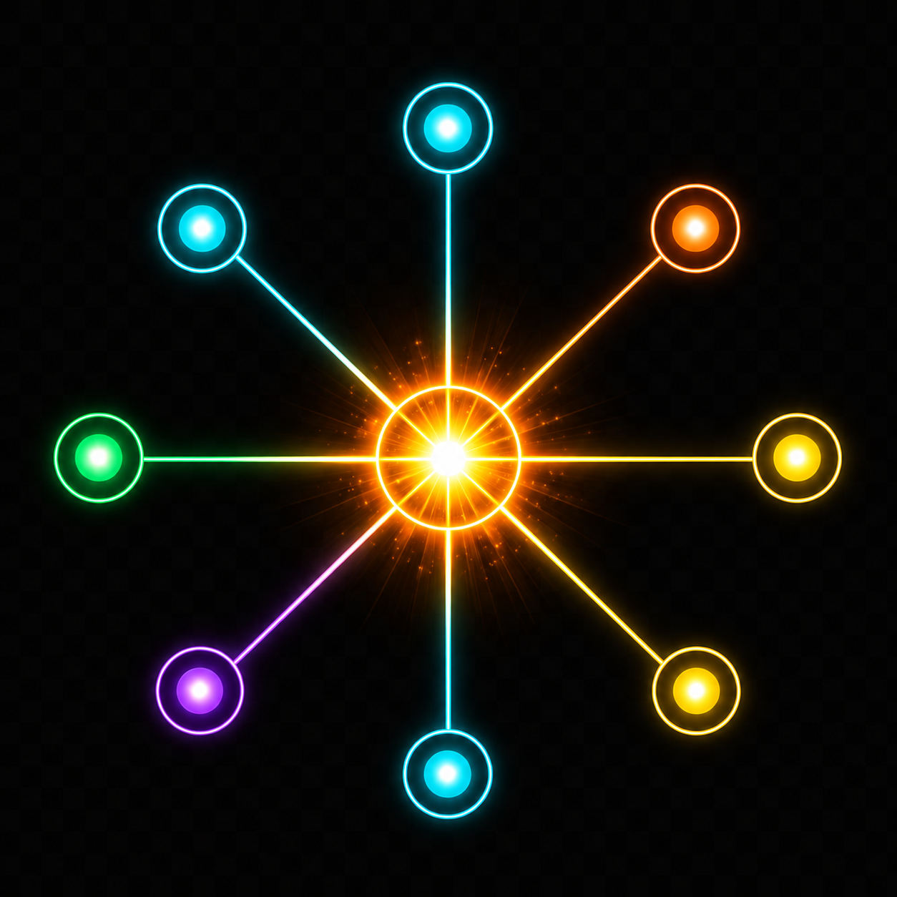

# SHACK-SERVER

<p align="center">
  
</p>

<h3 align="center">
Collect. Fuse. Prioritize.
</h3>

<p align="center">
Open-source platform for intelligent amateur radio information processing.
</p>

---

## Try it - demo on Windows, macOS or Linux

No Raspberry Pi and no transceiver needed. Install [Docker Desktop](https://www.docker.com/products/docker-desktop/), then run:

```bash
docker run -d --name shack-demo -p 3000:3000 ghcr.io/cgraf63/shack-server:demo
```

Open **http://localhost:3000**. The demo uses a simulated transceiver and real live DX spots; remote audio / transmit and online uploads are disabled and the log is limited. Remove it again with `docker rm -f shack-demo` (this also resets the demo data).

Details, limits and troubleshooting: [docs/DEMO_DOCKER.md](docs/DEMO_DOCKER.md). For the full version on a Raspberry Pi see [docs/INSTALLATION_EN.md](docs/INSTALLATION_EN.md).

## Why SHACK-SERVER?

Modern amateur radio operators receive information from many independent systems.

- DX Clusters
- DX Summit
- SOTAWatch
- POTA
- Reverse Beacon Network
- Radio CAT interfaces
- SDR
- and you need a logbook program and/or a contest software

Each system provides only a fragment of the complete picture.

SHACK-SERVER transforms fragmented information into a unified, explainable knowledge model that helps operators make better decisions in real time.

> **SHACK-SERVER is not another DX Cluster.**
>
> It is an **Amateur Radio Intelligence Platform.**

SHACK-SERVER runs on a raspberry Pi 4 with 1GB Ram or higher. Transceivers and SDR are directly connected to the raspberry PI.
Access to the PI is achieved using http witin the lan or https over the wan. On the router you need to open just 1 port: 443. 
As an alternative you can secure the https using cloudflare.


## Easy to use Contest Console - Multi OP capable


## Remote Control for Yaesu (including audio: Mic and Speaker) and CTR2-MIDI Integration Spectrum and Waterfall plus Remote Control over https !


## Fully blown internal SDR (SDR Receiver needed of Course) using our own code.


## Configurable uploads to QRZ, LoTW, Clublog


## WSJTX Integration


# Architecture

```text
                               SHACK-SERVER Architecture

                           Data Sources
                                 │
      ┌──────────────────────────┼──────────────────────────┐
      │                          │                          │
   DX Clusters              Radio Interface          External Services
      │                          │                          │
 HB9ON / HB9IAC              Yaesu / Icom          SOTA / POTA / RBN
 DX Summit                   Kenwood  /SDR                  |
      └──────────────────────────┼──────────────────────────┘
                                 │
                           Collectors
                                 │
                                 ▼
                          Message Classifier
                                 │
                                 ▼
                            Spot Parser
                                 │
                                 ▼
                           Incoming Spot
                                 │
                                 ▼
                           Fusion Engine
      ┌────────────────────────────────────────────────────────────┐
      │                                                            │
      │  • Duplicate Detection                                     │
      │  • Source Correlation                                      │
      │  • Context Enrichment                                      │
      │  • Distance Calculation                                    │
      │  • Bearing Calculation                                     │
      │  • Confidence Score                                        │
      └────────────────────────────────────────────────────────────┘
                                 │
                                 ▼
                            Master Spot
                                 │
                                 ▼
                            Rule Engine
      ┌────────────────────────────────────────────────────────────┐
      │                                                            │
      │  • Relevance Calculation                                   │
      │  • Operator Preferences                                    │
      │  • Explainable Decisions                                   │
      └────────────────────────────────────────────────────────────┘
                                 │
                                 ▼
                             Output Layer
                 ┌──────────────┼──────────────┬──────────────┐
                 ▼              ▼              ▼              ▼
            Dashboard      Telnet Server    REST API     WebSocket


## License

SHACK-SERVER is free software: you can redistribute it and/or modify it under the terms of the **GNU Affero General Public License v3.0 only** (AGPL-3.0-only). See [LICENSE](LICENSE) for the full text.

Copyright (C) 2025-2026 Christoph Graf, HB9ISO

### License change

Starting with the release following tag `v-gpl-final`, SHACK-SERVER is licensed under the AGPL-3.0. All versions up to and including `v-gpl-final` remain available under the GNU General Public License v3.0.

**What this means for you as a user:** nothing changes. You can use, modify and run SHACK-SERVER for your own station or your club free of charge, as before.

**What the AGPL adds:** if you modify SHACK-SERVER and make it available to others over a network (for example as a hosted service), you must also make your modified source code available to those users.

### Commercial licensing

If you want to use SHACK-SERVER under terms other than the AGPL-3.0, for example in a closed-source product or service, a commercial license is available. Contact: **license@shack-server.com**

### Trademark

"SHACK-SERVER" is the name of this project. The AGPL grants rights to the code, not to the name. Forks and modified versions must use a different name.

## Contributing

Contributions are welcome! Please read [CONTRIBUTING.md](CONTRIBUTING.md) first. All contributors must sign the [Contributor License Agreement](CLA.md) before a pull request can be merged.

