# Über dieses Handbuch {.unnumbered}

Dieses Handbuch erklärt die Bedienung des SHACK-SERVER aus Sicht eines Funkamateurs. Technische Details stehen nur dort, wo sie für die Nutzung oder die Fehlersuche wichtig sind.

Die Installation auf einem eigenen Raspberry Pi beschreibt die **Installationsanleitung** (`docs/INSTALLATION_DE.md` im Repository). Wer das fertige Image oder eine fertige SD-Karte hat, beginnt mit dem Kapitel [Erste Schritte](#erste-schritte).

Das Handbuch liegt zusammen mit dem Programm auf GitHub und wird mit jeder neuen Funktion nachgeführt. Die aktuelle Fassung als PDF:
<https://github.com/cgraf63/SHACK-SERVER/releases/tag/manual>

# Grundlagen und Übersicht

## Was SHACK-SERVER macht

Moderne Funkamateure bekommen Informationen aus vielen unabhängigen Quellen: DX-Cluster, DX Summit, HolyCluster, SOTA, POTA, Reverse Beacon Network, CAT-Schnittstelle des Transceivers, SDR, dazu Logbuch- und Contest-Programme. Jede Quelle liefert nur einen Ausschnitt.

SHACK-SERVER sammelt diese Daten, führt sie zusammen, bewertet sie und zeigt sie auf einem Dashboard – im Browser, von jedem Gerät aus.

- **DX-Spots aus mehreren Quellen** (DXSpider-Cluster, DX Summit, HolyCluster, RBN, SOTA, POTA), zusammengeführt in einer Fusion Engine: Derselbe Spot aus mehreren Quellen zählt einmal und bekommt mehr Gewicht.
- **DX-Score**: Die Stationen, die man noch braucht, stehen oben.
- **Ein Klick stimmt den Transceiver ab** (CAT), mit automatischem **Split** bei „UP 2“ oder „QSX“.
- **New – "needed" Callsigns**: Meldung, wenn ein neues Land oder ein neues Band-Land gespottet wird – ohne Rufzeichen einzutragen, auch als Push-Nachricht aufs Handy.
- **Logbuch** mit ADIF-Import und -Export, automatischem Upload zu **QRZ.com**, **Club Log** und **LoTW** sowie Übernahme der QSOs aus **WSJT-X**.
- **DXCC-Tabelle** und **aktuelle DXpeditionen**, verglichen mit dem eigenen Log.
- **Contest-Konsole** für mehrere Operatoren mit eigenem Contest-Log und Cabrillo-Export.
- **Fernsteuerung** des Transceivers über das Internet, mit Audio und Mikrofon, für Yaesu FTDX10, Yaesu FTX-1, Icom IC-7300 und RGO ONE; Unterstützung des CTR2-MIDI-Bedienteils.
- **Eingebautes SDR** (SDRplay RSP1B) mit Spektrum und Wasserfall.
- **Antennenrotor** über Hamlib.
- **Handy-App** mit Portabel-Log für POTA, SOTA und WWFF.
- **Eigener DX-Cluster** (Telnet, Port 8000) für andere Logprogramme.
- **Backup** nach Dropbox und/oder auf ein NAS.

## Hardware und Integrationskonzept

SHACK-SERVER wurde für den Raspberry Pi entwickelt. Ziel war ein schlankes, schnelles System mit einer professionellen grafischen Oberfläche, unabhängig von Desktop-PC und Notebook.

Der Prototyp läuft auf einem Raspberry Pi 4 mit 1 GB RAM und einer 32-GB-SD-Karte; das ist die Minimalkonfiguration. Empfohlen wird ein Raspberry Pi 4 oder 5 mit 2 GB RAM oder mehr und, wenn möglich, eine kleine SSD.

Die Idee: Der Raspberry Pi steht im Shack, die Funkgeräte hängen per USB am Pi – nicht am PC oder Notebook. Linux hat eine sehr stabile USB-Unterstützung. Ebenfalls per USB wird der SDRplay RSP1B angeschlossen. Auf den Geräten, mit denen man SHACK-SERVER bedient, muss nichts installiert werden.

Bedient wird SHACK-SERVER ausschliesslich im Browser: am PC, Notebook, Tablet oder Handy. Im Heimnetz genügt `http://`, für Mikrofon-Audio und den Zugriff von unterwegs braucht es `https://` (siehe [Zugriff von unterwegs](#zugriff-von-unterwegs)). Mehrere Operatoren können gleichzeitig arbeiten, zum Beispiel in einem Contest.

Die Darstellung ist für Bildschirme ab 1920 × 1080 Punkten optimiert. Für das Handy gibt es eine eigene Oberfläche (siehe [Handy-App und Portabel-Log](#handy-app-und-portabel-log)).

## Softwarearchitektur

Der Server ist in **TypeScript** geschrieben und läuft mit **Node.js**. Die Oberfläche im Browser besteht aus HTML, CSS und JavaScript. Für das SDRplay-SDR gibt es ein kleines Hilfsprogramm in C.

Die Daten liegen in einer **SQLite**-Datenbank. Sie lässt sich auch im laufenden Betrieb sichern; das eingebaute Backup kopiert sie täglich nach Dropbox, Google Drive, OneDrive oder auf ein NAS (siehe [Backup](#backup)).

Für die Transceiver gibt es eigene Treiber (Yaesu FTDX10, Yaesu FTX-1, RGO ONE, Icom IC-7300, Icom CI-V, QRP Labs QMX) und zusätzlich die Bibliothek **Hamlib** für rund 400 weitere Modelle.

Externe Dienste wie QRZ.com, Club Log, LoTW, SOTA, POTA, NOAA und SIDC sind eingebunden, damit alles auf einem Dashboard zusammenkommt.

Der Code wurde mit Unterstützung von ChatGPT und Claude entwickelt. Technische Details zur Architektur stehen im Repository auf GitHub.

# Erste Schritte

## Mit dem fertigen Image oder der fertigen SD-Karte

1. **Image auf die SD-Karte schreiben** (nur beim Download): im **Raspberry Pi Imager** unter *Use custom* die Datei `shack-server-…-arm64.img.xz` wählen. In den Einstellungen des Imagers lassen sich WLAN, Benutzer und SSH vorgeben – das ist optional. Bei einer fertigen Karte entfällt dieser Schritt.
2. **Karte einstecken**, Transceiver per USB anschliessen, Strom einschalten. Der erste Start dauert 1–2 Minuten.
3. **Netzwerk:**
   - Mit **Netzwerkkabel** oder einem im Imager eingetragenen WLAN geht es direkt weiter mit Schritt 4.
   - Sonst öffnet SHACK-SERVER nach etwa 1,5 Minuten das WLAN **SHACK-SERVER-Setup**. Mit dem Handy verbinden; die Einrichtungsseite öffnet sich von selbst (sonst `http://10.42.0.1` aufrufen). Heim-WLAN wählen, Passwort eingeben, **Connect**. Danach das Handy wieder mit dem Heim-WLAN verbinden.
4. Im Browser **http://shack-server.local:3000** öffnen. Es erscheint der [Setup-Assistent](#setup-assistent).

Falls `shack-server.local` nicht aufgeht (manche Android-Geräte): Im Router die IP-Adresse des Geräts „shack-server“ nachsehen und `http://<IP-Adresse>:3000` öffnen.

Zum WLAN später: Das Setup-WLAN erscheint nur, wenn SHACK-SERVER gar kein Netz hat. Ist schon ein WLAN gespeichert, wartet er zuerst 10 Minuten – nach einem Stromausfall braucht der Router oft etwas länger als der Pi.

## Mit eigener Installation

Die Installation auf einem eigenen Raspberry Pi (Raspberry Pi OS Lite, 64 Bit) beschreibt die Installationsanleitung. Das Installationsskript richtet alles ein und zeigt am Schluss die Adresse des Setup-Assistenten.

## Setup-Assistent

Beim ersten Aufruf führt der Setup-Assistent in vier Schritten durch die Grundeinstellungen:

1. **Station** – Rufzeichen, Name, Locator. Land, CQ- und ITU-Zone werden aus dem Rufzeichen ermittelt.
2. **Transceiver** – Modell wählen, USB-Schnittstelle wählen, **Test connection**. Bei Erfolg zeigt der Assistent die aktuelle Frequenz.
3. **QRZ.com** – Benutzername und Passwort für die Rufzeichen-Abfrage (Name, Locator, Bild der Gegenstation). Ein XML-Abonnement bei QRZ.com ist für die vollständigen Daten nötig.
4. **Fertig** – mit Links zu den optionalen Funktionen: Log-Uploads, LoTW, Backup, Benachrichtigungen und weitere.

Jeder Schritt kann übersprungen werden. Den Assistenten erreicht man später jederzeit über den Link *setup assistant* in *Settings → Station* oder über `/setup` – zum Beispiel, um das QRZ.com-Login zu ändern.

## Updates

**Settings → Software update** zeigt, ob eine neue Version bereitsteht, und installiert sie per Knopfdruck. Danach im Browser die Seite mit **Ctrl+F5** neu laden. Versionen sind nummeriert, z. B. **v1.0.3**: Die ersten beiden Stellen setzt ein Release (v1.0.0, v1.1.0 …), die letzte zählt jede Änderung danach hoch.

# Dashboard

Das Dashboard ist die zentrale Seite des SHACK-SERVER. Hier kommen Stationsdaten, Ausbreitung, DX- und Live-Spots sowie der aktive Transceiver zusammen. Die Seitenleiste links lässt sich mit dem kleinen Pfeil ein- und ausklappen.

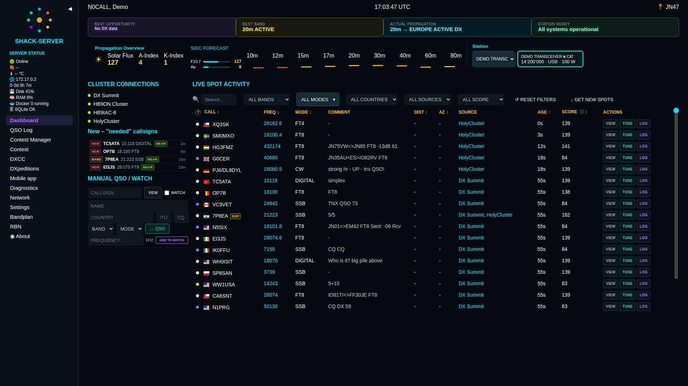

## Propagation Overview

Die Propagation-Anzeige zeigt die aktuellen Ausbreitungsbedingungen. Quelle ist die NOAA (National Oceanic and Atmospheric Administration, USA).

## SIDC Forecast

Der SIDC Forecast ist – im Gegensatz zu den aktuellen NOAA-Werten – eine Vorhersage der Ausbreitung für die nächsten Stunden. Quelle ist das Solar Influences Data Analysis Center in Brüssel.

## Best Opportunity

Best Opportunity zeigt den Spot mit dem höchsten [DX-Score](#der-dx-score) – also die Station, die sich im Moment am meisten lohnt. Ein Klick öffnet das QSO-Fenster.

## Actual Propagation

Actual Propagation vergleicht das Modell (NOAA/SIDC) mit der Wirklichkeit (Anzahl aktueller DX-Spots pro Band):

| Anzeige | Bedeutung |
|---|---|
| **OPENING** | Modell und Spots passen zusammen: Das Band ist offen. |
| **ACTIVE** | Viele Spots, obwohl das Modell nur mittelmässige Bedingungen erwartet. |
| **POSSIBLE** | Das Modell sieht gut aus, aber im Moment ist kaum Aktivität. |

## Station und aktiver Transceiver

Im Bereich **Station** steht der aktive Transceiver mit Name, CAT-Status, Frequenz, Betriebsart und Leistung. Links daneben wählt man aus den eingerichteten Transceivern den aktiven aus; es ist immer nur einer aktiv.

Ist ein Transceiver mit eigener Fernsteuerungsseite aktiv (FTDX10, FTX-1, IC-7300, RGO ONE), öffnet der Knopf mit seinem Namen diese Seite (siehe [Fernsteuerung](#fernsteuerung)).

## Rotorsteuerung

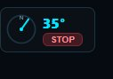{width=25%}

Ist ein Antennenrotor eingerichtet, erscheint im Bereich Station ein Kompass mit der aktuellen Richtung und einer **STOP**-Taste. Ein Klick auf den **AZ**-Wert eines Spots dreht die Antenne in diese Richtung. Die Einrichtung steht im Kapitel [Antennenrotor](#antennenrotor).

## Manual QSO / Watch

Manual QSO dient dazu, schnell ein Rufzeichen nachzuschlagen, das nicht in den Live-Spots erscheint – und das QSO bei Bedarf gleich zu speichern.

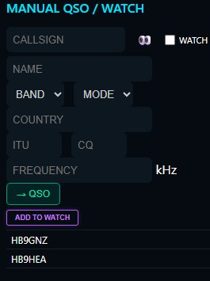{width=32%} 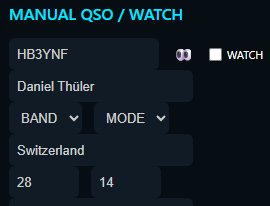{width=36%}

Ist ein Transceiver per CAT verbunden, übernehmen **Band, Mode und Frequenz** laufend dessen Werte (grün **kHz · CAT**). Änderst du ein Feld von Hand oder übernimmst einen Spot-Vorschlag, bleibt dein Wert stehen; sobald das Rufzeichenfeld geleert wird, folgen die Felder wieder dem Transceiver.

- **Enter** oder **VIEW** fragt QRZ.com ab: Name, Land, Zonen, Locator.
- **VIEW** (die „Augen“) öffnet zusätzlich ein Fenster mit Karte und QRZ-Bild.
- **→ QSO** öffnet das QSO-Fenster mit den übernommenen Daten.

### Rufzeichen-Prüfung beim Tippen

Schon beim Tippen öffnet sich unter dem Feld eine Liste:

- sofort das **Land** des Präfixes mit CQ- und ITU-Zone – „SQ2“ ergibt Polen. Land und Zonen werden gleich ins Formular übernommen.
- **Vorschläge**, die wahrscheinlichsten zuerst:
  - Stationen, die gerade **gespottet** sind, vor allem nahe der Transceiver-Frequenz (grünes Abzeichen **◉ HERE**). Wer „SQ2…“ auf 14.025 MHz gehört hat, findet die dort gespottete Station ganz oben.
  - Rufzeichen aus dem **eigenen Log** (`LOG 3×`) und der **Watch-Liste**.
  - die **SCP-Datenbank** (Super Check Partial) mit rund 180'000 aktiven Rufzeichen von Club Log, wöchentlich aktualisiert.
- Der getippte Teil darf irgendwo im Rufzeichen stehen: „Q2A“ findet SQ2ABC. Ein `?` steht für ein Zeichen, das man nicht verstanden hat: „SQ2?BC“.
- **Falsch verstanden?** Rufzeichen mit genau einem Zeichen anders, zu viel oder zu wenig erscheinen mit `≈`. Zeichen, die in CW oder SSB ähnlich klingen (S/H/5, B/D/6, M/N, P/T …), kommen dabei zuerst.
- Klickt man ins **leere Feld**, zeigt die Liste, wer gerade auf der eigenen Frequenz gespottet ist.

Mit den Pfeiltasten und **Enter** oder per Klick übernimmt man einen Vorschlag: Rufzeichen, Band, Mode und Frequenz werden eingetragen und die QRZ-Abfrage läuft.

### Watch-Liste

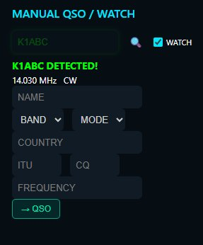{width=32%}

Mit **WATCH** oder **ADD TO WATCH** kommt ein Rufzeichen auf die Watch-Liste; beliebig viele Rufzeichen sind möglich. Sobald die Station gespottet wird, zeigt das Dashboard einen Alarm, zum Beispiel „K1ABC DETECTED! 14.030 MHz CW“. Auf Wunsch kommt zusätzlich eine Push-Nachricht aufs Handy (siehe [Benachrichtigungen](#benachrichtigungen)).

## New – "needed" Callsigns

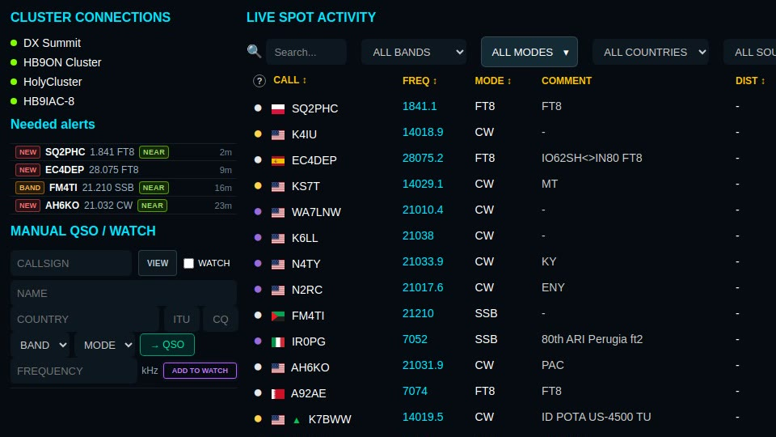

Unter der Watch-Liste stehen die zuletzt gespotteten Stationen, die man noch braucht – verglichen mit dem eigenen Log nach DXCC-Gebiet: **NEW COUNTRY**, **NEW BAND COUNTRY** und optional neues Band oder neuer Mode für eine schon gearbeitete Station. **NEAR** heisst: Ein Spotter in der Nähe des eigenen QTH hat die Station gehört. Ein Klick stimmt den Transceiver ab. Einrichtung: siehe [Benachrichtigungen](#benachrichtigungen).

## DX- und Live-Spots

Die Live-Spots zeigen die aktuell gemeldeten Stationen mit Frequenz, Mode, Land, Entfernung, Richtung, Quelle und Score.

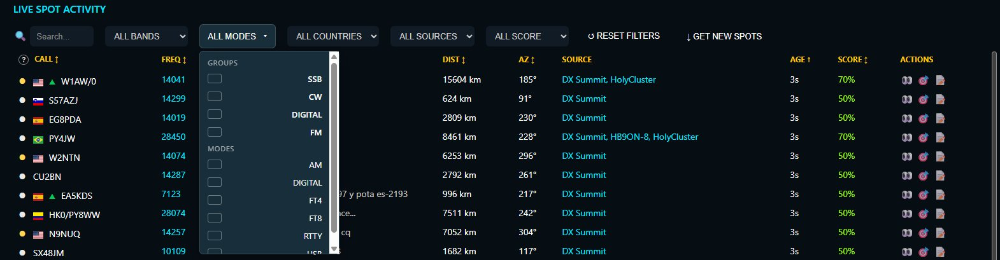

- Alle Spalten lassen sich auf- und absteigend **sortieren**, die wichtigen Felder haben **Filter**: Band, Mode (Mehrfachauswahl), Land, Quelle.
- **Reset filters** löscht alle Filter, **Get new spots** holt neue Spots und behält die Filter.
- Ein Mauszeiger über der Flagge zeigt das Land.
- **Augen** (VIEW): Fenster mit Weltkarte, Distanz und Richtung zwischen dem eigenen QTH und der DX-Station.
- **Zielscheibe** (TUNE): stellt Frequenz und Mode am Transceiver ein.
- **Notizblock**: öffnet das QSO-Fenster; Frequenz und Mode sowie Name und Locator aus QRZ.com werden übernommen.
- **AZ**: dreht den Rotor in Richtung der Station.

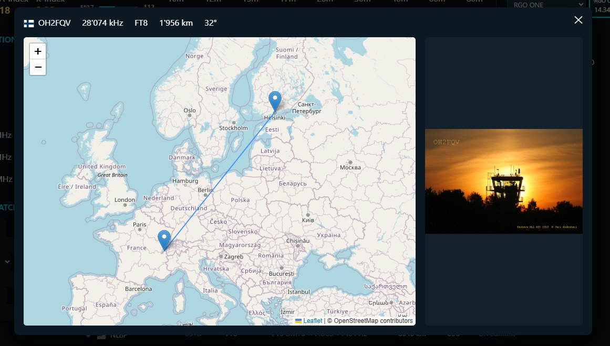

### Spot-Informationen

Die farbigen Punkte links der Flagge zeigen, ob Station, Land und Band schon gearbeitet sind. Ein Klick auf **?** zeigt die Legende.

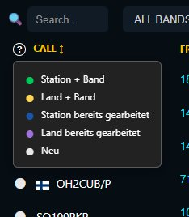{width=25%}

**POTA**-Stationen sind mit einem grünen Dreieck markiert, **SOTA**-Stationen mit einem weissen. So sieht man sofort, ob man es mit einer Park- oder Gipfelaktivierung zu tun hat.

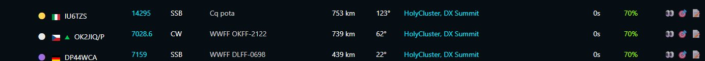

Steht im Spot „UP 2“, „UP 1-3“, „DOWN 1“, „QSX 14025“ oder „LSN 14.205“, zeigt die Liste den **Split** als oranges Abzeichen neben der Frequenz (siehe [Split](#split)). Ein grünes **NEAR** heisst: in der Nähe des eigenen QTH gehört.

Die Besonderheit von SHACK-SERVER: Neben den DX-Clustern werden auch **HolyCluster** und **DX Summit** abgefragt. Die Daten werden in der Fusion Engine zusammengeführt und angereichert – unter anderem mit Land, Entfernung, Richtung, Zonen sowie SOTA- und POTA-Informationen.

### Der DX-Score

Der Score setzt sich aus mehreren unabhängigen Teilen zusammen:

| Kriterium | Bedingung | Punkte |
|---|---|---:|
| Worked-Status: neu | Station, Land und Band neu | +100 |
| Worked-Status: Land | Land bekannt, Station/Band offenbar neu | 0 |
| Worked-Status: Station | Station schon gearbeitet | −20 |
| Worked-Status: Land-Band | Land gearbeitet, aber auf diesem Band neu | +60 |
| Worked-Status: Station-Band | Station auf diesem Band schon gearbeitet | −80 |
| Neues Band für Land | Land bekannt, aber noch nicht auf diesem Band | +60 |
| Neue Station auf Band | Rufzeichen bekannt, aber noch nicht auf diesem Band | +30 |
| Neue Station | Worked-Status „neu“ | +15 |
| Multi-Cluster | Spot aus 2 oder mehr Quellen | +20 |
| In der Nähe gehört | Spotter in der Nähe des eigenen QTH (NEAR) | +15 |
| Confidence | 0–100 % | 0 bis +15 |
| Spot-Alter unter 60 s | sehr frisch | +15 |
| Spot-Alter 60–179 s | | +10 |
| Spot-Alter 180–299 s | | +5 |
| Spot-Alter ab 300 s | | 0 |
| Entfernung über 8000 km | | +15 |
| Entfernung 5000–8000 km | | +11 |
| Entfernung 2000–5000 km | | +7 |
| Entfernung bis 2000 km | | +3 |

# QSO erfassen

Ein Klick auf den Notizblock eines Spots (oder **→ QSO** bei Manual QSO) öffnet das QSO-Fenster. Frequenz und Mode werden übernommen, QRZ.com liefert Name und Locator.

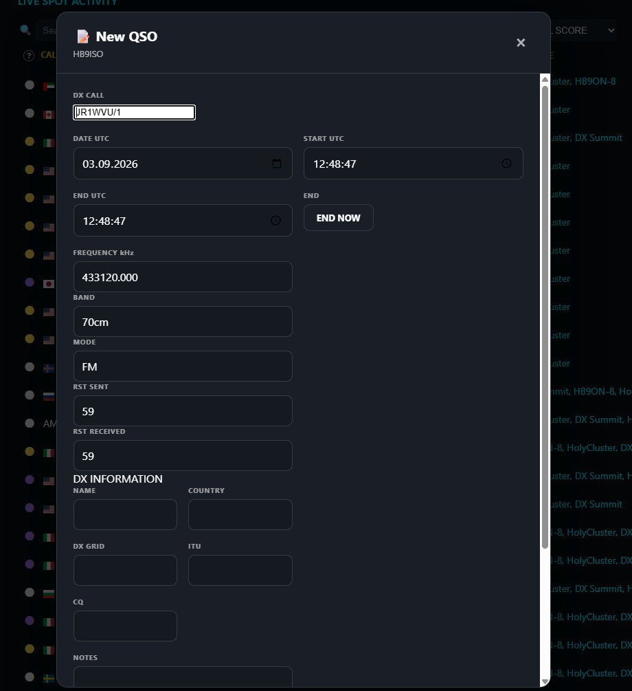{width=50%}

Gespeicherte QSOs landen im [QSO-Log](#qso-log) und werden – wenn eingerichtet – automatisch zu QRZ.com, Club Log und LoTW hochgeladen.

# QSO-Log

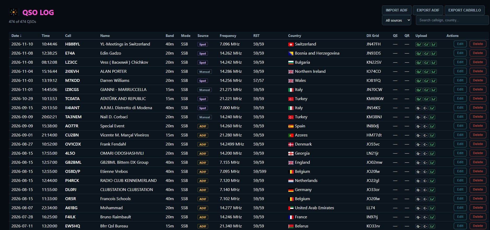

Das QSO-Log verwaltet alle QSOs. Die Tabelle lässt sich nach Datum, Zeit, Rufzeichen, Name, Band, Mode, Quelle, Frequenz, Land und weiteren Feldern sortieren. Mit **Edit** und **Delete** lassen sich QSOs bearbeiten und löschen.

- **Source** zeigt, woher ein QSO stammt: **Spot** (aus den Live-Spots), **Manual** (von Hand erfasst), **ADIF** (importiert) oder zum Beispiel WSJT-X. Das Auswahlfeld **All sources** zeigt nur eine Quelle.
- **QS** / **QR**: QSL-Karte gesendet / erhalten.

Die Spalte **Upload** zeigt für jedes QSO den Stand bei QRZ.com (Q), Club Log (C) und LoTW (L): ✓ hochgeladen, … wartend, ✖ Fehler. Der Mauszeiger über dem Zeichen zeigt Zeitpunkt oder Fehlermeldung. Bestätigungen aus LoTW werden angezeigt und zählen in der [DXCC-Tabelle](#dxcc-tabelle).

## Suche

Über das Suchfeld findet man QSOs nach Rufzeichen oder Land.

## ADIF-Import und -Export

**IMPORT ADIF** liest bestehende Logdaten ein, zum Beispiel aus einem früheren Logprogramm. **EXPORT ADIF** erstellt eine ADIF-Datei für andere Logprogramme. POTA-, SOTA- und WWFF-Referenzen werden dabei übernommen.

## Online-Logbücher

SHACK-SERVER lädt neue QSOs im Hintergrund automatisch hoch. Eingerichtet wird das unter **Settings → Log Uploads**, mit einem Konto pro eigenem Rufzeichen. Portabel-Rufzeichen (/P, /M, /QRP …) werden automatisch dem Konto zugeordnet, andere Formen (zum Beispiel A61/HB9BC) über Aliase.

| Dienst | Was man braucht |
|---|---|
| **QRZ.com** | API-Schlüssel des QRZ-Logbuchs (QRZ.com → Logbook → Settings) |
| **Club Log** | E-Mail und App-Passwort von Club Log; der Club-Log-API-Schlüssel wird einmal pro Installation eingetragen |
| **LoTW** | Rufzeichen-Zertifikat (.p12) aus TQSL; für Bestätigungen zusätzlich das LoTW-Web-Login |

**Test** prüft die Zugangsdaten. **Upload existing QSOs** stellt auch das bestehende Log ein.

### LoTW (Logbook of the World)

SHACK-SERVER signiert die QSOs selbst – TQSL ist auf dem Pi nicht nötig.

1. In TQSL am PC: *Callsign Certificates* → Rechtsklick auf das Rufzeichen → *Save the Callsign Certificate File*. Es entsteht eine `.p12`-Datei (Passwort optional).
2. *Settings → Log Uploads*: das Logbuch-Konto speichern, dann **Add certificate (.p12)**. Ein gesetztes Passwort vor der Dateiauswahl eintragen.
3. **LoTW** ankreuzen und speichern. Neue QSOs werden im Hintergrund hochgeladen; **Upload existing QSOs** stellt das bestehende Log ein (nur QSOs im Zeitraum des Zertifikats).
4. Für Bestätigungen das **LoTW-Web-Login** eintragen. Bestätigungen werden alle 6 Stunden geholt (oder mit **Fetch confirmations**) und zählen in der DXCC-Tabelle als bestätigt.

Als Standort dienen der Locator aus *Settings → Station*, die DXCC-Nummer aus dem Zertifikat und die Zonen des Landes. Hat ein Land mehrere Zonen, lassen sie sich pro Konto einstellen. Noch nicht unterstützt sind US-Staaten, Countys, kanadische Provinzen und andere Unterteilungen.

# DXCC-Tabelle

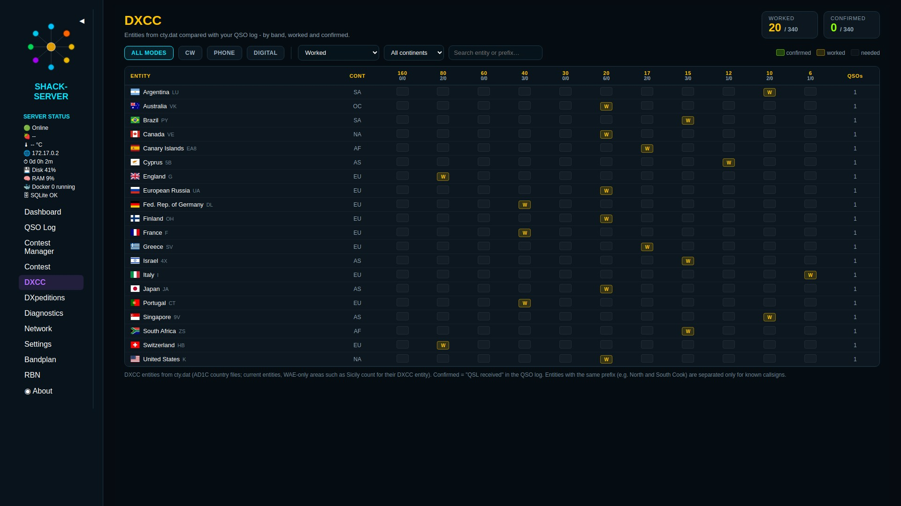

Die DXCC-Tabelle zeigt alle 340 DXCC-Gebiete über die Bänder 160 m bis 6 m: gearbeitet oder bestätigt (QSL oder LoTW), wahlweise für alle Modes, CW, Phone oder Digital. Filter zeigen zum Beispiel nur die fehlenden Gebiete (*Needed*), die gearbeiteten, aber noch nicht bestätigten, oder einen einzelnen Kontinent.

# DXpeditionen

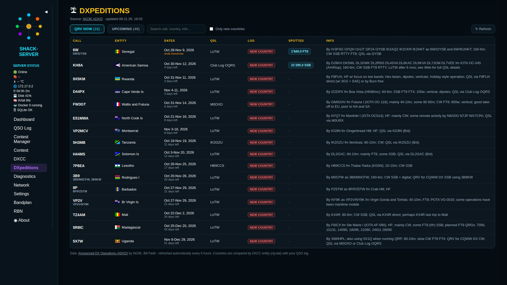

Die Seite **DXpeditions** zeigt angekündigte DX-Unternehmungen (Quelle: NG3K ADXO), wird automatisch aktualisiert und mit dem eigenen Log verglichen. **QRV NOW** sind die laufenden, **UPCOMING** die kommenden. Wird eine DXpedition gerade gespottet, stimmt ein Klick den Transceiver ab.

# Contest

Die Contest-Konsole dient dem schnellen Arbeiten während eines Contests. Sie enthält Contest-Auswahl, Contest-Session, Bandstatistik, QSO-Erfassung und eine Live-Bandanzeige.

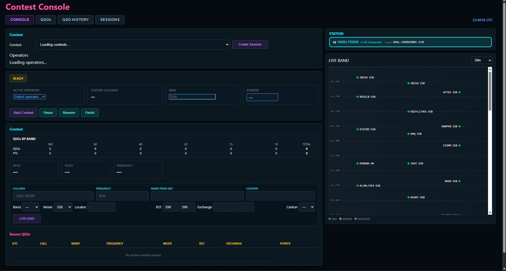

## Contest-Session

Nach der Wahl eines Contests legt man eine Session an, startet, pausiert und beendet sie. Die Contests selbst werden im [Contest Manager](#contest-manager) erfasst. Mehrere Operatoren können gleichzeitig an verschiedenen Stationen arbeiten – alle über dieselbe Adresse. Sessions und Contest-QSOs sind über das Menü oben links erreichbar. Contest-QSOs werden getrennt vom normalen Logbuch gespeichert.

## QSO-Erfassung

Die QSO-Erfassung enthält Rufzeichen, Name, Locator, RST gesendet und empfangen sowie die Exchange-Felder. Welche Exchange-Felder nötig sind, legt die Contest-Konfiguration fest. Ist als gesendeter Exchange **Serial Number** eingestellt, trägt SHACK-SERVER die nächste laufende Nummer selbst ein: die höchste bisher gesendete Nummer der Session plus 1 – über alle Operatoren hinweg. Bei **CQ Zone**, **ITU Zone** oder **Locator** kommt der Wert aus dem Stationsrufzeichen (Klubrufzeichen) und dem Locator des Contests im Contest Manager. Ein Klick auf einen Spot in der Live-Bandanzeige trägt Rufzeichen, Mode und Frequenz ein.

Beim Tippen des Rufzeichens erscheint wie im Dashboard die **Rufzeichen-Prüfung**: Land und Zonen aus dem Präfix, Vorschläge aus Spots, eigenem Log und der SCP-Datenbank. Zusätzlich zeigt jeder Vorschlag den Contest-Stand der Session: **DUPE** (rot), wenn das Rufzeichen auf dem gewählten Band schon geloggt ist, und gelb die Bänder, auf denen es bereits gearbeitet wurde. Mit ↑/↓ und Enter oder per Klick wird ein Vorschlag übernommen – bei einem Spot auch Band, Mode und Frequenz, und mit CAT wird der Transceiver auf den Spot abgestimmt. Enter loggt das QSO nur, wenn kein Vorschlag markiert ist. Das erste Esc schliesst die Liste, das zweite leert die Erfassung.

## Live-Band

Die Live-Bandanzeige zeigt die Spot-Aktivität auf dem gewählten Band. Die Beschriftungen sind auf mehrere Spuren verteilt, damit sie sich nicht überlagern.

## QSO-Historie und Cabrillo

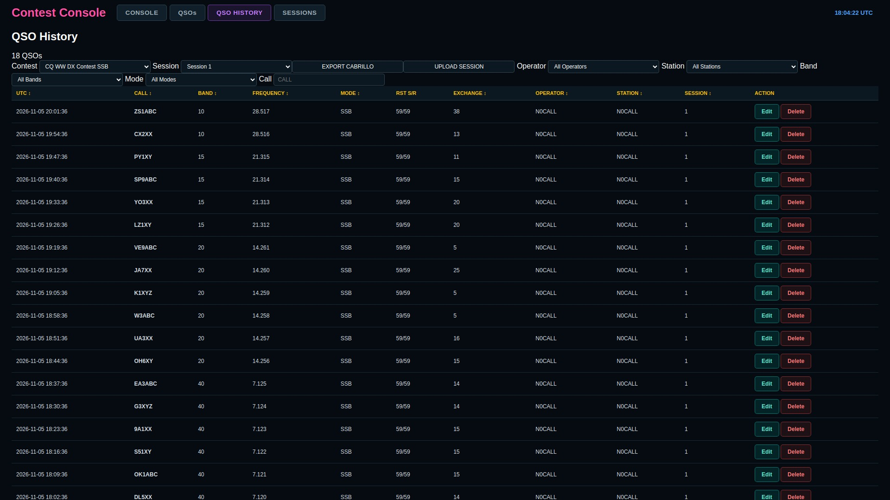

Die QSO-Historie zeigt alle Contest-QSOs mit Operator und Station. Der **Cabrillo-Export** erstellt die Datei für die Einsendung an den Contest-Veranstalter; sie enthält nur die gewählte Contest-Gruppe.

# Contest Manager

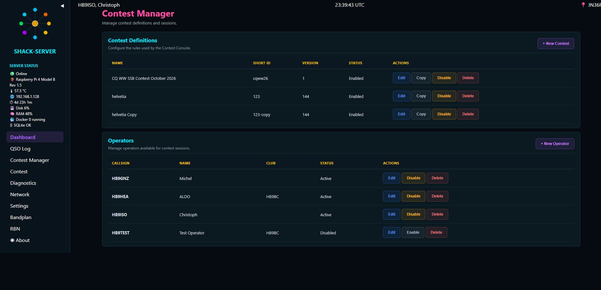

Der Contest Manager verwaltet die Contests: Hier werden sie erfasst und danach in der Contest-Konsole gewählt und gestartet. Auch die Rufzeichen, die an Contests teilnehmen, werden hier erfasst.

# Station und Transceiver

SHACK-SERVER bedient alle Transceiver über eine gemeinsame Schnittstelle. Das Dashboard, die Spots und das Log funktionieren deshalb mit jedem unterstützten Gerät gleich.

## Unterstützte Geräte

| Transceiver | Anbindung | Status |
|---|---|---|
| Yaesu FTDX10 | USB / CAT, eigener Treiber | integriert, mit Fernsteuerungsseite |
| Yaesu FTX-1 | USB / CAT, eigener Treiber | integriert, mit Fernsteuerungsseite |
| RGO ONE | USB / CAT, eigener Treiber | integriert, mit Fernsteuerungsseite |
| Icom IC-7300, IC-7300MK2 | USB / CI-V, eigener Treiber | integriert, mit Fernsteuerungsseite und Scope; Test am Gerät offen |
| Icom IC-705 und andere Icom | USB / CI-V, eigener Treiber | vorbereitet, Hardwaretest offen |
| QRP Labs QMX / QMX+ | USB / CAT, eigener Treiber | vorbereitet, Hardwaretest offen |
| rund 400 weitere Modelle | Hamlib | integriert |

## Transceiver einrichten

**Settings → Transceivers → + Add Transceiver**:

1. **Transceiver / Treiber** wählen – einen eigenen Treiber oder **Hamlib - other transceivers** mit Hersteller und Modell.
2. **Serial port** wählen. Erkannte Schnittstellen erscheinen mit lesbarem Namen; bei Yaesu-Geräten mit zwei Schnittstellen ist der CAT-Port markiert.
3. **Baud rate** – muss zur CAT-Einstellung im Menü des Transceivers passen. Bei Hamlib meist *Model default*.
4. Bei Icom zusätzlich die **CI-V-Adresse**.
5. **Test connection** – zeigt bei Erfolg die aktuelle Frequenz, sonst die Ursache im Klartext (Gerät aus, falsche Baudrate, Port belegt …).
6. **Save transceiver** – gilt sofort, ohne Neustart.

Der Transceiver verbindet sich automatisch neu, wenn er eingeschaltet oder das USB-Kabel wieder eingesteckt wird.

## Aktiven Transceiver wählen

Im Dashboard wird nur der aktive Transceiver angezeigt. Die Auswahl erfolgt über das Auswahlfeld links neben der Station-Karte.

## CAT-Status

Die Station-Karte zeigt, ob eine CAT-Verbindung besteht. Ohne Verbindung fehlen Frequenz und Betriebsart oder werden als unbekannt angezeigt. Erste Hilfe: Ist der Transceiver eingeschaltet? Stimmt die Baudrate? Ist das USB-Kabel eingesteckt? Details zeigt die Seite [Diagnostics](#diagnostics).

## Transceiver mit anderen Programmen teilen

Eine serielle Schnittstelle kann nur ein Programm gleichzeitig öffnen. Soll der Transceiver zusätzlich von WSJT-X oder einem Logprogramm gesteuert werden, startet man ein gemeinsames `rigctld` und wählt in SHACK-SERVER beim Treiber **Hamlib** die Verbindung **Existing rigctld**.

## Split

Steht im Spot „UP 2“, „UP 1-3“, „DOWN 1“, „QSX 14025“, „QSX 025“ oder „LSN 14.205“, setzt **TUNE** die Empfangsfrequenz auf VFO A, die Sendefrequenz auf VFO B und schaltet Split ein. Das Abstimmen auf einen Spot ohne Split schaltet Split wieder aus. FT8- und FT4-Spots werden ohne Split abgestimmt (DXpedition-Modus in WSJT-X).

Unterstützt: Yaesu FTDX10, Yaesu FTX-1, RGO ONE und alle Transceiver über Hamlib mit Split-Steuerung. Ausschalten unter *Settings → Split & CW*. Unter *Settings → Split & CW* stellt man ausserdem das **CW-Seitenband** ein: CW-U oder CW-L (Icom: CW bzw. CW-R). Es gilt für jeden CW-Spot und jeden Klick auf „CW“, auf allen Bändern.

# Fernsteuerung

Die Fernsteuerungsseiten bedienen den Transceiver im Browser – im Shack oder über das Internet, mit Empfangs-Audio und Mikrofon. Mikrofon-Audio funktioniert nur über `https://` (Browser-Vorgabe).

## Yaesu FTDX10

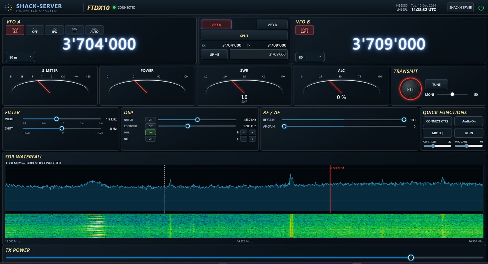

Die Oberfläche des FTDX10 lehnt sich an das Gerät an: VFO A und B, alle Modes, Filter (Width, Shift), Notch, Contour, DNR, NB, RF- und AF-Gain, PTT, Spektrum und Wasserfall über das SDR. Das CTR2-MIDI-Bedienteil wird unterstützt. Umschaltbar zwischen der klassischen Yaesu-Ansicht und einer einfarbigen Darstellung.

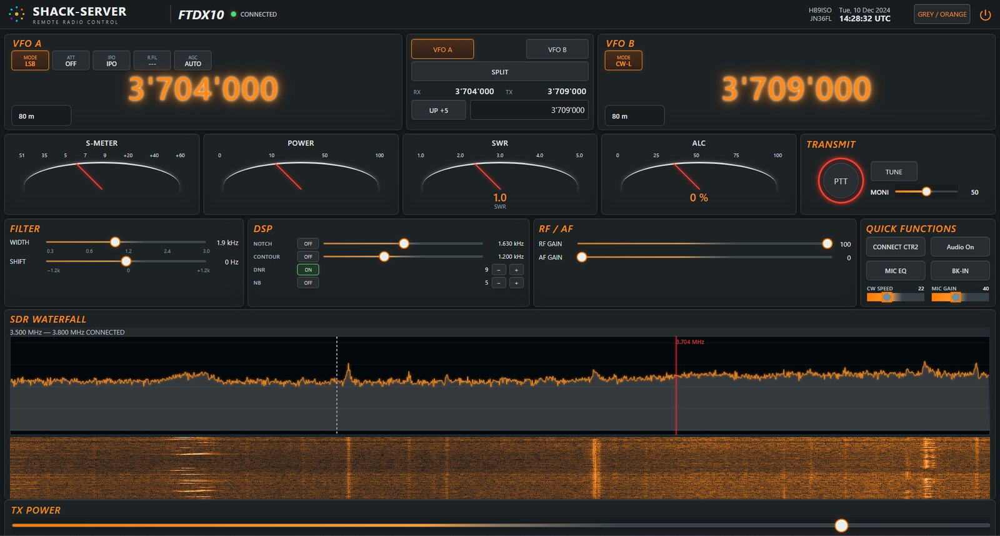

## Yaesu FTX-1

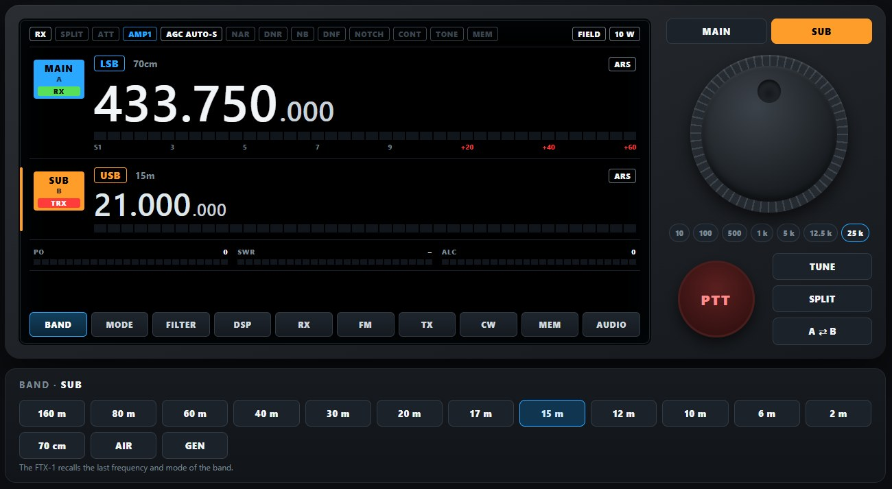

Ist der FTX-1 der aktive Transceiver, öffnet der Knopf **FTX-1** im Dashboard eine eigene Seite, gestaltet nach dem Display des Geräts:

- **MAIN** und **SUB** wie am Gerät; die Sendeseite ist rot mit **TRX** markiert, die andere grün mit **RX**.
- S-Meter, PO, SWR, ALC.
- Abstimmknopf (ziehen, Mausrad oder Pfeiltasten; Schritte von 10 Hz bis 25 kHz), PTT (Knopf halten oder Leertaste), Tuner, Split.
- Alle Bänder einschliesslich **2 m, 70 cm** und Flugfunk, alle Modes einschliesslich C4FM.
- Filter, DSP (DNR, NB, DNF, Notch, Contour, APF), AF, RF, Squelch, ATT, Vorverstärker, AGC.
- FM-Relaisablage, CTCSS und DCS.
- Sendeleistung (Field-Head 0,5–10 W, mit SPA-1 / Optima 5–100 W), Mic-Gain, Prozessor.
- CW-Tempo, Break-in, CW-Speicher 1–5, Empfangs-Audio.

**MEM – Speicherkanäle:** **READ CHANNELS** liest die Kanäle 1–99 mit Name, Frequenz, Mode, Ablage und Ton (etwa 10 Sekunden). Ein Kanal lässt sich auf MAIN oder SUB abrufen; CH ▲/▼ blättert, QMB legt ab und ruft ab. Die aktuelle Einstellung von MAIN oder SUB lässt sich mit Namen in einen Kanal speichern (mit Rückfrage vor dem Überschreiben), Kanäle lassen sich umbenennen.

Die Seite passt ohne Scrollen auf einen Bildschirm mit 1920 × 1080 Punkten.

## Icom IC-7300

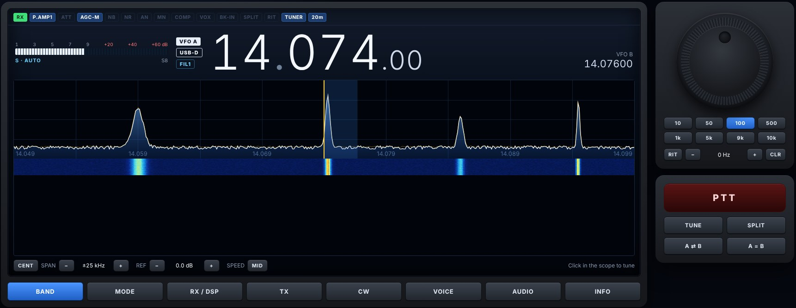

Ist der IC-7300 (oder IC-7300MK2) der aktive Transceiver, öffnet der Knopf **IC-7300** im Dashboard eine eigene Seite im Stil des IC-7300-Touchscreens:

- **Spektrum und Wasserfall direkt aus dem IC-7300** über USB – kein SDR nötig. Ein Klick ins Spektrum stimmt dorthin ab, das Mausrad stimmt im eingestellten Schritt. CENT/FIX, Span (±2,5 kHz bis ±500 kHz), Referenzpegel und Geschwindigkeit wie am Gerät. Das Gerät sendet die Scope-Daten nur, solange die Seite offen ist.
- **Frequenz:** Mausrad über einer Ziffer stimmt genau diese Stelle; Klick auf die Frequenz öffnet die Eingabe. Abstimmknopf (ziehen oder Mausrad), Schritte 10 Hz bis 10 kHz, Pfeiltasten.
- **Statuszeile** wie oben im Display: RX/TX, P.AMP, ATT, AGC, NB, NR, AN, MN, COMP, VOX, BK-IN, SPLIT, RIT, TUNER, Band.
- **Instrument:** S, PO, SWR, ALC – Klick wechselt, AUTO zeigt beim Senden PO.
- **Soft-Keys** unten: BAND, MODE (mit DATA, FIL1–3, Twin-PBT), RX/DSP (P.AMP, ATT, AGC, NB, NR, AN, MN, RF-Gain, Squelch), TX (Leistung, Mic-Gain, Kompressor, VOX, Monitor, Tuner), CW (Tempo, Break-in, Text senden, Makros F1–F5), VOICE (Sprachspeicher T1–T8), AUDIO.
- **PTT** (Knopf halten oder Leertaste), TUNE, SPLIT, A⇄B, A=B, RIT.

Einstellungen am IC-7300: *SET › Connectors › CI-V*: **CI-V USB Baud Rate** 115200, **CI-V Address** 94h (IC-7300MK2: B6h), **CI-V Transceive** ON, **CI-V USB Echo Back** OFF. In SHACK-SERVER als Treiber **Icom IC-7300 / IC-7300MK2** wählen.

## RGO ONE, QRP Labs QMX und andere

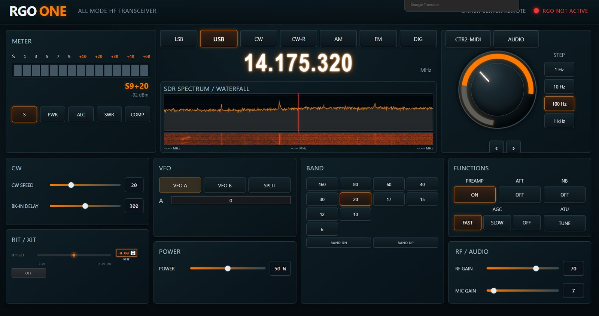

Für den RGO ONE gibt es eine eigene Fernsteuerungsseite mit Modes, Abstimmschritten, CW-Tempo, Break-in, Leistung, Bändern, AGC, Tuner sowie RF- und Mic-Gain.

Wie bei Yaesu wird der Wasserfall nicht über USB übertragen; dafür ist das SDRplay-SDR eingebunden (siehe [SDR](#sdr-sdrplay-rsp1b)). Weitere Geräte mit CAT lassen sich mit wenig Aufwand einbinden; für Remote-Betrieb mit Audio braucht das Gerät nur eine USB-Soundkarte.

## CTR2-MIDI

Das Bedienteil **CTR2-MIDI** von Lynovation hat einen bequemen VFO-Knopf und sechs Tasten. Es wird **nicht** am Raspberry Pi angeschlossen, sondern per USB am Computer oder Tablet, auf dem die Fernsteuerungsseite läuft. Der Browser liest es über WebHID (Chrome oder Edge, über `https://`). Ein Schritt am Knopf ändert die Frequenz des aktiven VFO um 10 Hz.

# SDR (SDRplay RSP1B)

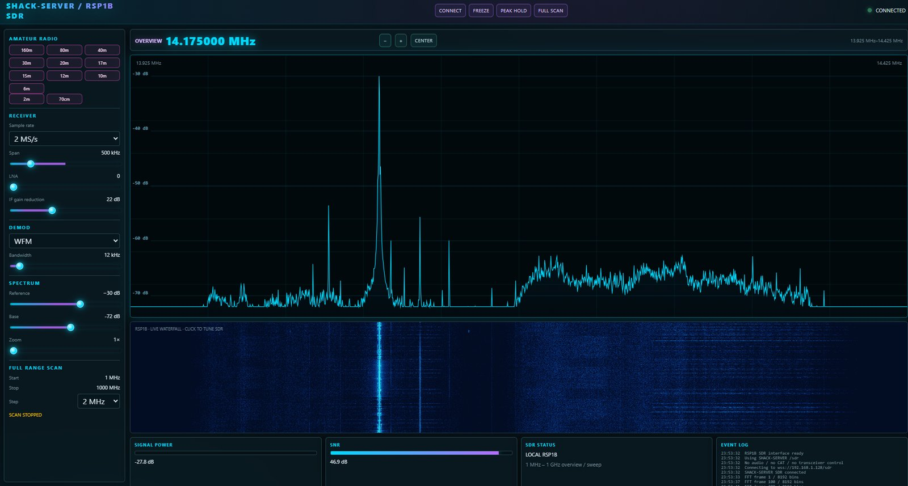

SHACK-SERVER hat eine eigene SDR-Seite für den **SDRplay RSP1B**: Spektrum und Wasserfall, Demodulation, Spitzenwert-Anzeige, Bandübersicht von 160 m bis 70 cm und ein Suchlauf über den ganzen Bereich.

Auf den Fernsteuerungsseiten dient der RSP1B als separates SDR für Spektrum und Wasserfall des Transceivers. Er ist unabhängig vom CAT-Anschluss; die Frequenz des Transceivers bestimmt, welcher Ausschnitt angezeigt wird.

**CONNECT / DISCONNECT:** Der RSP1B läuft nur, solange ihn jemand braucht – im Betrieb belegt er einen ganzen Prozessorkern des Raspberry Pi. **DISCONNECT** stoppt ihn auf dem Server (Anzeige oben rechts **STOPPED**), **CONNECT** startet ihn wieder (**CONNECTED**). Zusätzlich schaltet er sich selbst ab: 60 Sekunden nachdem die letzte Seite geschlossen wurde und wenn die SDR-Seite oder eine Fernsteuerungsseite 60 Sekunden im Hintergrund liegt. Ein laufender **FULL SCAN** wird nicht unterbrochen. Beim nächsten Öffnen startet er von selbst.

Die SDR-Seite wird unter *Settings → Optional Modules* eingeschaltet.

# RBN & Memory

Das **Reverse Beacon Network (RBN)** ist ein weltweites Netz von Empfangsstationen (Skimmern), die die Amateurfunkbänder laufend abhören. Sie dekodieren CW und digitale Betriebsarten, erkennen das Rufzeichen, messen Signalstärke (SNR) und Tempo und melden das sofort.

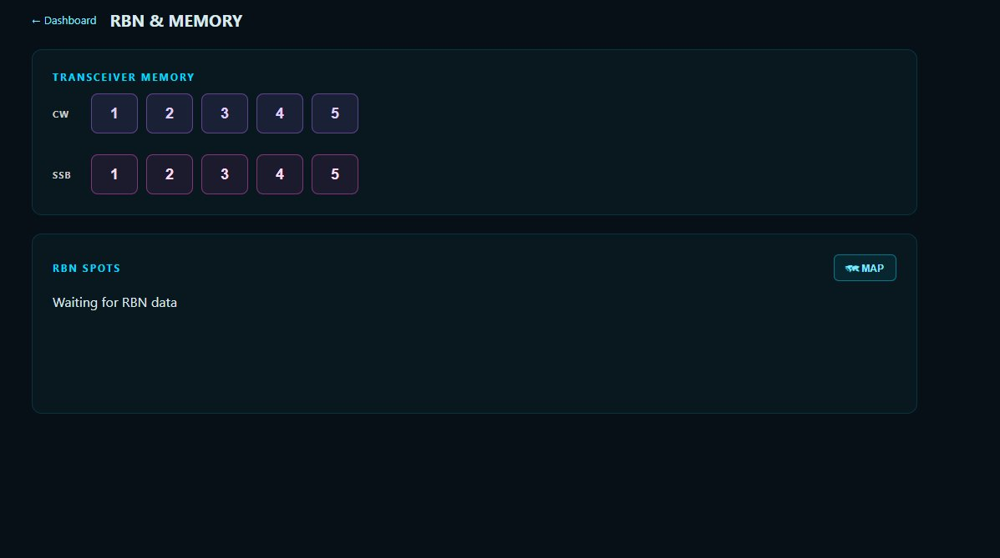

Die Seite **RBN & Memory** verbindet beides:

- **Transceiver Memory**: zehn Tasten für die Sprach- oder CW-Speicher des Transceivers (Yaesu) sowie Frequenz und Mode, die man hier auch ändern kann.
- **RBN Spots**: Sobald Skimmer das eigene Rufzeichen melden, erscheinen sie in der Liste und auf der Karte – man sieht sofort, wie gut und wohin das eigene Signal gerade kommt. Typisch: CQ über eine Speichertaste senden und zusehen, wer einen hört.

Die Seite wird unter *Settings → Optional Modules* eingeschaltet. Unabhängig davon nutzt SHACK-SERVER den kompletten RBN-Datenstrom für die Live-Spots und für „Heard near you“.

# SOTA und POTA

SOTA- und POTA-Aktivierungen werden aus den Spots erkannt und in den Live-Spots markiert: POTA mit einem grünen, SOTA mit einem weissen Dreieck. SOTA-Spots kommen über den SOTA-Cluster, POTA-Spots über die POTA-Schnittstelle.

Fallen diese Markierungen aus, funktioniert SHACK-SERVER selbst trotzdem; meist ist der externe Dienst gerade nicht erreichbar. Die Seite [Diagnostics](#diagnostics) zeigt solche Störungen.

Wer selbst aktiviert, nutzt das Portabel-Log der [Handy-App](#handy-app-und-portabel-log).

# Handy-App und Portabel-Log

Auf dem Handy die Adresse des SHACK-SERVER mit `/m` öffnen, zum Beispiel `https://shack.example.ch/m`, und **Zum Home-Bildschirm** wählen (iPhone: Teilen-Menü, Android: Browser-Menü oder der Knopf *Install*). Für die Installation als App ist `https://` nötig.

Die App zeigt:

- neue "needed" Callsigns und Treffer der Watch-Liste,
- Live-Spots – antippen stimmt den Transceiver ab, mit Split,
- den Transceiver: Band, Mode, Split aus, Rotor,
- ein schnelles QSO-Log.

**Portabel-Log:** Im Tab LOG auf **PORTABLE** umschalten. Eigenes Rufzeichen mit /P oder /M, Locator vom Handy-GPS, POTA-, SOTA- oder WWFF-Referenz (und die Referenz der Gegenstation für Park-zu-Park oder Gipfel-zu-Gipfel), Band und Mode mit einem Tipp, auch 2 m und 70 cm.

Ohne Netz – auf dem Gipfel, im Park – bleiben die QSOs auf dem Handy und werden automatisch übertragen, sobald SHACK-SERVER wieder erreichbar ist, jedes QSO nur einmal. Die Referenzen gehen in den ADIF-Upload. Der Zähler zeigt die QSOs der Aktivierung (POTA 10, SOTA 4, WWFF 44).

# Benachrichtigungen

SHACK-SERVER prüft jeden neuen Spot – auch wenn kein Browser offen ist – und schickt bei Treffern eine Push-Nachricht aufs Handy. Dafür wird die kostenlose App **ntfy** verwendet.

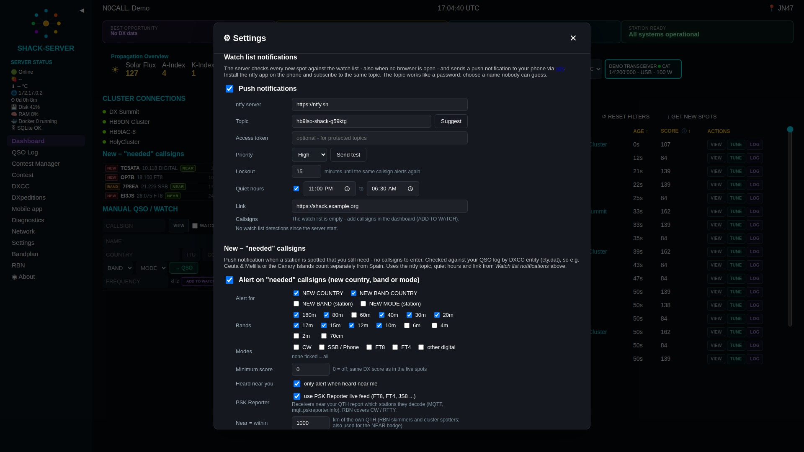

## Einrichten

1. App **ntfy** installieren (Android oder iOS).
2. **Settings → Watch list notifications**: *Push notifications* ankreuzen, mit **Suggest** einen schwer erratbaren Topic-Namen erzeugen, **Save**.
3. In der ntfy-App: *Subscribe to topic* mit demselben Topic-Namen (Server ntfy.sh).
4. **Send test**.

**Sperrzeit** (Standard 15 Minuten) verhindert wiederholte Alarme derselben Station, **Ruhezeiten** unterdrücken Nachrichten in der Nacht. Unter **Link** trägt man die Adresse des eigenen SHACK-SERVER ein; ein Tipp auf die Nachricht öffnet ihn.

## Watch-Liste

Die Glocke 🔔 neben jedem Rufzeichen der Watch-Liste schaltet die Push-Nachricht für dieses Rufzeichen ein oder aus. Beispiel: `FW3GT DETECTED – 14.001 MHz CW – Wallis & Futuna – via RBN`.

## New – "needed" Callsigns

**Settings → New – "needed" callsigns** meldet Stationen, die man noch braucht – ohne Rufzeichen einzutragen. Verglichen wird mit dem Log nach DXCC-Gebiet; Kanarische Inseln, asiatisches Russland und so weiter zählen separat.

- Stufen: **NEW COUNTRY**, **NEW BAND COUNTRY**, optional **NEW BAND** und **NEW MODE** für eine schon gearbeitete Station.
- Filter: Bänder, Modes, Mindest-Score, *nur wenn in meiner Region gehört*.
- Sperrzeit pro Land und Band: Ein Pileup meldet sich nur einmal.

## Heard near you

Eine Station gilt als **in der Nähe gehört** (NEAR), wenn ein Spotter im eingestellten Umkreis des eigenen QTH (Standard 1000 km) sie in den letzten 15 Minuten auf diesem Band gemeldet hat. Quellen sind der komplette RBN-Datenstrom, die Spotter der DX-Cluster und optional der **PSK Reporter** für FT8, FT4 und andere digitale Modes.

# WSJT-X

QSOs, die in **WSJT-X** oder **JTDX** geloggt werden, übernimmt SHACK-SERVER automatisch ins Log und lädt sie wie alle anderen QSOs hoch.

1. **Settings → WSJT-X**: *Receive QSOs from WSJT-X / JTDX* ankreuzen, Port (Standard 2237).
2. In WSJT-X: *Settings → Reporting → UDP Server* = IP-Adresse des SHACK-SERVER, Port wie oben, *Accept UDP requests* ankreuzen.

Teilen sich mehrere Programme (JTAlert, GridTracker) den Datenstrom, trägt man an beiden Orten dieselbe Multicast-Adresse ein, zum Beispiel 224.0.0.1.

# Antennenrotor

SHACK-SERVER dreht die Antenne über Hamlib. Unterstützt werden alle Steuergeräte, die Hamlib kennt, zum Beispiel Yaesu GS-232, SPID Rot2Prog, Hy-Gain DCU-1, ERC und K3NG.

1. **Settings → Rotator** → **Use a rotator** ankreuzen.
2. **Controller on a serial port**: Hersteller, Modell und Schnittstelle wählen (Baudrate meist *Model default*).
   Oder **Existing rotctld**: Host und Port eines bereits laufenden `rotctld`, zum Beispiel gemeinsam mit PSTRotator oder N1MM.
3. **Test** zeigt die aktuelle Antennenrichtung.
4. **Save**.

Danach erscheint im Dashboard der Kompass. Ein Klick auf den **AZ**-Wert eines Spots dreht die Antenne; die Spot-Details (VIEW) bieten Short Path und Long Path.

# Telnet-Server / DX-Cluster auf Port 8000

SHACK-SERVER ist auf Port **8000** selbst ein DX-Cluster und lässt sich so in andere Logprogramme einbinden – mit allen zusammengeführten Spots. Als Adresse die IP-Adresse oder den Namen des SHACK-SERVER angeben, Port 8000; beim Login das eigene Rufzeichen. Ein Passwort ist nicht nötig.

# Netzwerk und System

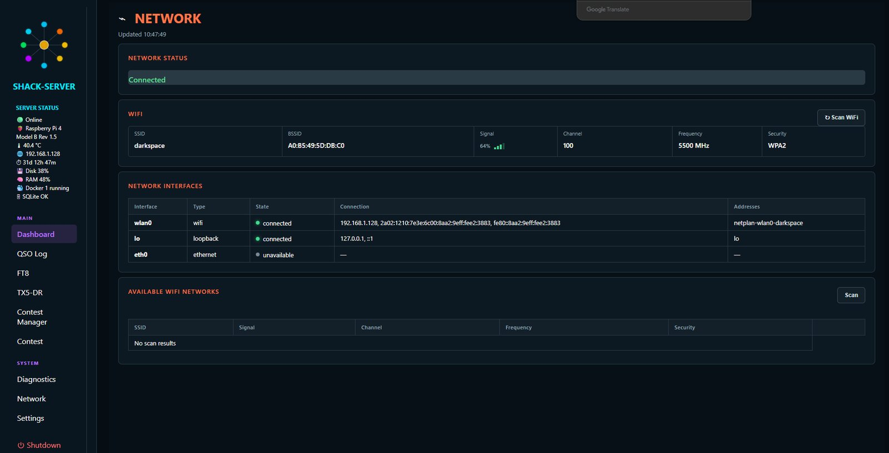

Die Seite **Network** zeigt Netzwerk und Systemzustand des Raspberry Pi. Für unterwegs gibt es einen **WLAN-Suchlauf**: verfügbare WLANs anzeigen und sich mit einem verbinden.

Unter den Systemaktionen lassen sich SHACK-SERVER neu starten, der Raspberry Pi neu starten und ausschalten.

## Zugriff von unterwegs

SHACK-SERVER hat keine eigene Anmeldung. Für den Zugriff aus dem Internet deshalb nie einfach einen Port im Router weiterleiten, sondern einen geschützten Weg verwenden, zum Beispiel **Cloudflare Access**: Nur freigegebene Personen kommen nach einer Anmeldung durch. Die Einrichtung beschreibt die Installationsanleitung. Dasselbe gilt für die Handy-App unterwegs und das Mikrofon-Audio, das `https://` braucht.

# Settings

Die Settings öffnet man über **Settings** in der Seitenleiste. Sie sind in Abschnitte gegliedert:

| Abschnitt | Inhalt | Kapitel |
|---|---|---|
| Station | Rufzeichen, Name, Locator, Klub; Link zum Setup-Assistenten (auch für das QRZ.com-Login) | [Erste Schritte](#erste-schritte) |
| Transceivers | Transceiver einrichten, testen, aktivieren | [Station und Transceiver](#station-und-transceiver) |
| DX Sources | DX-Cluster (DXSpider), DX Summit, HolyCluster ein- und ausschalten, eigene Cluster hinzufügen | [DX- und Live-Spots](#dx--und-live-spots) |
| Log Uploads | QRZ.com, Club Log, LoTW pro Rufzeichen | [Online-Logbücher](#online-logbücher) |
| WSJT-X | QSOs aus WSJT-X / JTDX übernehmen | [WSJT-X](#wsjt-x) |
| Split & CW | automatischen Split ein- und ausschalten, CW-Seitenband (CW-U / CW-L) | [Split](#split) |
| Rotator | Antennenrotor | [Antennenrotor](#antennenrotor) |
| Watch list notifications | Push-Nachrichten, Sperrzeit, Ruhezeiten | [Benachrichtigungen](#benachrichtigungen) |
| New – "needed" callsigns | Meldungen für neue Länder und Bänder, Heard near you | [Benachrichtigungen](#benachrichtigungen) |
| Backup | tägliche Sicherung nach Dropbox / NAS | [Backup](#backup) |
| Software update | neue Version installieren | [Updates](#updates) |
| Optional Modules | RBN & Memory, SDR | [RBN & Memory](#rbn-memory), [SDR](#sdr-sdrplay-rsp1b) |

Zugangsdaten (Passwörter, API-Schlüssel) bleiben auf dem SHACK-SERVER und werden nie an den Browser zurückgeschickt. Ein leeres Passwortfeld heisst: Das gespeicherte Passwort bleibt.

# Backup

**Settings → Backup** sichert QSO- und Contest-Log, Einstellungen und Transceiver einmal täglich zur eingestellten Uhrzeit. Wie viele Sicherungen aufbewahrt werden, ist einstellbar.

- **Dropbox, Google Drive, OneDrive …** über *rclone*. Das Ziel wird einmal auf dem Pi eingerichtet (siehe Installationsanleitung), danach in den Settings zum Beispiel `dropbox:SHACK-SERVER` eintragen und **Test** drücken.
- **NAS (SMB)**: Adresse, Freigabe, Ordner, Benutzer und Passwort des NAS. **Test** prüft den Zugriff.

**Backup now** sichert sofort. Die letzten drei Sicherungen bleiben zusätzlich auf dem Pi. Das Wiederherstellen beschreibt die Installationsanleitung.

# Datenimport und -export

**ADIF** ist das zentrale Austauschformat für Logdaten. Der Import übernimmt bestehende QSOs in den SHACK-SERVER, der Export erlaubt die Weiterverwendung in anderen Logprogrammen (siehe [QSO-Log](#qso-log)).

**Cabrillo** wird für Contest-Logs verwendet und enthält nur die gewählte Contest-Gruppe (siehe [Contest](#contest)).

# Diagnostics

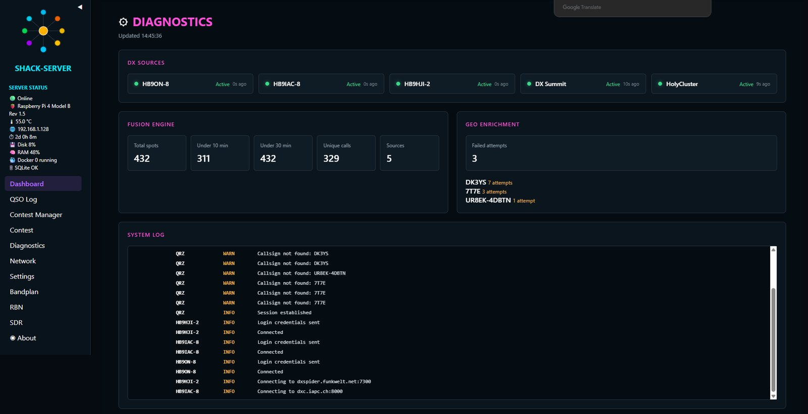

Die Seite **Diagnostics** zeigt den Zustand von SHACK-SERVER: Verbindungen zu den DX-Clustern, CAT, Probleme mit externen Diensten (SOTA, POTA, QRZ.com, Uploads) und Rufzeichen, zu denen QRZ.com keinen Eintrag findet. **Run System Check** startet eine aktuelle Prüfung.

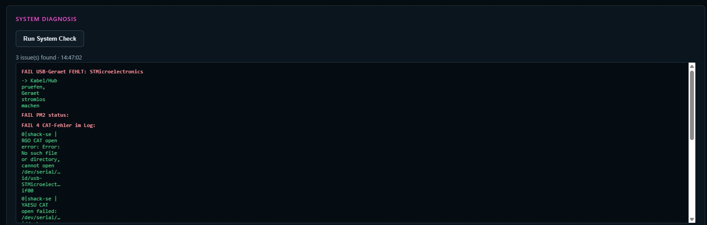

# Bandplan

Unter **Bandplan** in der Seitenleiste stehen die Bandpläne von 160 m bis 70 cm.

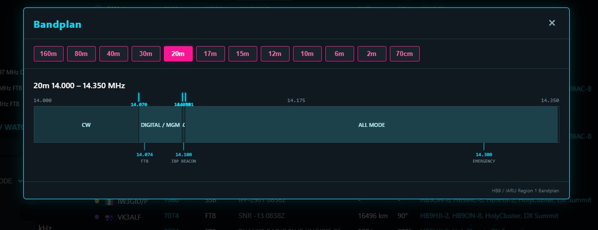

# Anhang

## Begriffe

| Begriff | Bedeutung |
|---|---|
| ADIF | Amateur Data Interchange Format – Austauschformat für Logdaten |
| Cabrillo | Standardformat für Contest-Logs |
| CAT | Computer Aided Transceiver – Steuerung eines Transceivers durch Software |
| CI-V | Steuerprotokoll von Icom |
| Club Log | Online-Logbuch und DXCC-Auswertung |
| DXCC | DX Century Club – Liste der 340 DXCC-Gebiete |
| Hamlib | Bibliothek zur Steuerung von Transceivern und Rotoren |
| LoTW | Logbook of the World der ARRL – elektronische QSL-Bestätigung |
| NOAA | National Oceanic and Atmospheric Administration, USA |
| ntfy | kostenloser Dienst für Push-Nachrichten aufs Handy |
| POTA | Parks on the Air |
| PSK Reporter | Netz von Empfangsstationen für digitale Modes |
| QRZ.com | Rufzeichen-Datenbank und Online-Logbuch |
| RBN | Reverse Beacon Network |
| SCP | Super Check Partial – Liste aktiver Rufzeichen |
| SIDC | Solar Influences Data Analysis Center, Brüssel |
| SOTA | Summits on the Air |
| WWFF | World Wide Flora and Fauna |

## Adressen und Ports

| Adresse / Port | Zweck |
|---|---|
| `http://shack-server.local:3000` | Weboberfläche im Heimnetz (fertiges Image) |
| `/setup` | Setup-Assistent |
| `/m` | Handy-App |
| `/ftx1` | Fernsteuerung Yaesu FTX-1 |
| Port 3000 | Weboberfläche (HTTP) |
| Port 443 | Weboberfläche über HTTPS (mit Caddy, optional) |
| Port 8000 | eigener DX-Cluster (Telnet) |
| UDP 2237 | Empfang der QSOs aus WSJT-X / JTDX |
