# About this manual {.unnumbered}

This manual explains how to use SHACK-SERVER from a radio amateur's point of view. Technical details are only given where they matter for operating or troubleshooting.

Installing SHACK-SERVER on your own Raspberry Pi is described in the **installation guide** (`docs/INSTALLATION_EN.md` in the repository). If you have the ready-made image or a ready-made SD card, start with the chapter [Getting started](#getting-started).

The manual is kept on GitHub together with the program and is updated with every new feature. The current version as PDF:
<https://github.com/cgraf63/SHACK-SERVER/releases/tag/manual>

# Basics and overview

## What SHACK-SERVER does

Radio amateurs today get information from many independent sources: DX clusters, DX Summit, HolyCluster, SOTA, POTA, the Reverse Beacon Network, the CAT interface of the transceiver, an SDR, plus logging and contest programs. Each source only shows part of the picture.

SHACK-SERVER collects this data, fuses it, rates it and shows it on one dashboard – in the browser, on any device.

- **DX spots from several sources** (DXSpider clusters, DX Summit, HolyCluster, RBN, SOTA, POTA), fused in a fusion engine: the same spot from several sources counts once and gets more weight.
- **DX score**: the stations you still need are at the top.
- **One click tunes the transceiver** (CAT), with automatic **split** for "UP 2" or "QSX".
- **New – "needed" callsigns**: an alert when a new country or a new band country is spotted – without entering callsigns, also as a push notification on your phone.
- **Logbook** with ADIF import and export, automatic upload to **QRZ.com**, **Club Log** and **LoTW**, and QSOs taken over from **WSJT-X**.
- **DXCC table** and **current DXpeditions**, compared with your own log.
- **Contest console** for several operators with its own contest log and Cabrillo export.
- **Remote control** of the transceiver over the internet, with audio and microphone, for the Yaesu FTDX10, Yaesu FTX-1, Icom IC-7300 and RGO ONE; support for the CTR2-MIDI controller.
- **Built-in SDR** (SDRplay RSP1B) with spectrum and waterfall.
- **Antenna rotator** via Hamlib.
- **Phone app** with a portable log for POTA, SOTA and WWFF.
- **Own DX cluster** (Telnet, port 8000) for other logging programs.
- **Backup** to Dropbox and/or a NAS.

## Hardware and integration concept

SHACK-SERVER was developed for the Raspberry Pi. The goal was a lean, fast system with a professional graphical interface that does not depend on a desktop PC or notebook.

The prototype runs on a Raspberry Pi 4 with 1 GB RAM and a 32 GB SD card; this is the minimum. A Raspberry Pi 4 or 5 with 2 GB RAM or more is recommended, if possible with a small SSD.

The idea: the Raspberry Pi sits in the shack and the transceivers are connected to the Pi by USB – not to the PC or notebook. Linux has very stable USB support. The SDRplay RSP1B is connected by USB as well. Nothing has to be installed on the devices you use to operate SHACK-SERVER.

SHACK-SERVER is operated in the browser only: on a PC, notebook, tablet or phone. In the home network `http://` is enough; microphone audio and access from outside need `https://` (see [Access from outside](#access-from-outside)). Several operators can work at the same time, for example in a contest.

The layout is optimized for screens of 1920 × 1080 pixels and more. The phone has its own interface (see [Phone app and portable log](#phone-app-and-portable-log)).

## Software architecture

The server is written in **TypeScript** and runs on **Node.js**. The browser interface consists of HTML, CSS and JavaScript. A small helper program in C connects the SDRplay SDR.

The data is kept in an **SQLite** database. It can be backed up while SHACK-SERVER is running; the built-in backup copies it daily to Dropbox, Google Drive, OneDrive or a NAS (see [Backup](#backup)).

The transceivers are controlled by SHACK-SERVER's own drivers (Yaesu FTDX10, Yaesu FTX-1, RGO ONE, Icom IC-7300, Icom CI-V, QRP Labs QMX) and by the **Hamlib** library for about 400 more models.

External services such as QRZ.com, Club Log, LoTW, SOTA, POTA, NOAA and SIDC are integrated so that everything comes together on one dashboard.

The code was developed with the help of ChatGPT and Claude. Technical details of the architecture are in the repository on GitHub.

# Getting started

## With the ready-made image or SD card

1. **Write the image to the SD card** (download only): in the **Raspberry Pi Imager**, choose *Use custom* and select the file `shack-server-…-arm64.img.xz`. In the Imager's settings you can preset Wi-Fi, user and SSH – this is optional. With a ready-made card, skip this step.
2. **Insert the card**, connect the transceiver by USB, switch on. The first start takes 1–2 minutes.
3. **Network:**
   - With a **network cable** or a Wi-Fi entered in the Imager, continue with step 4.
   - Otherwise, after about 1.5 minutes SHACK-SERVER opens the Wi-Fi **SHACK-SERVER-Setup**. Join it with your phone; the setup page opens by itself (otherwise open `http://10.42.0.1`). Choose your home Wi-Fi, enter the password, **Connect**. Then connect the phone to your home Wi-Fi again.
4. In the browser, open **http://shack-server.local:3000**. The [setup assistant](#setup-assistant) appears.

If `shack-server.local` does not open (some Android devices): look up the IP address of the device "shack-server" in your router and open `http://<IP address>:3000`.

About the Wi-Fi later on: the setup Wi-Fi only appears when SHACK-SERVER has no network at all. If a Wi-Fi is already saved, it first waits 10 minutes – after a power cut the router often takes longer to start than the Pi.

## With your own installation

Installing on your own Raspberry Pi (Raspberry Pi OS Lite, 64-bit) is described in the installation guide. The installation script sets everything up and shows the address of the setup assistant at the end.

## Setup assistant

On the first visit, the setup assistant guides you through the basic settings in four steps:

1. **Station** – callsign, name, locator. Country, CQ and ITU zone are derived from the callsign.
2. **Transceiver** – choose the model and the USB port, **Test connection**. If it works, the assistant shows the current frequency.
3. **QRZ.com** – user name and password for callsign lookups (name, locator, picture of the other station). Full data needs a QRZ.com XML subscription.
4. **Done** – with links to the optional features: log uploads, LoTW, backup, notifications and more.

Every step can be skipped. You can open the assistant again at any time with the *setup assistant* link in *Settings → Station* or at `/setup` – for example to change the QRZ.com login.

## Updates

**Settings → Software update** shows whether a new version is available and installs it with one click. Afterwards reload the page in the browser with **Ctrl+F5**.

# Dashboard

The dashboard is SHACK-SERVER's main page. Station data, propagation, DX and live spots and the active transceiver come together here. The sidebar on the left can be collapsed and expanded with the small arrow.

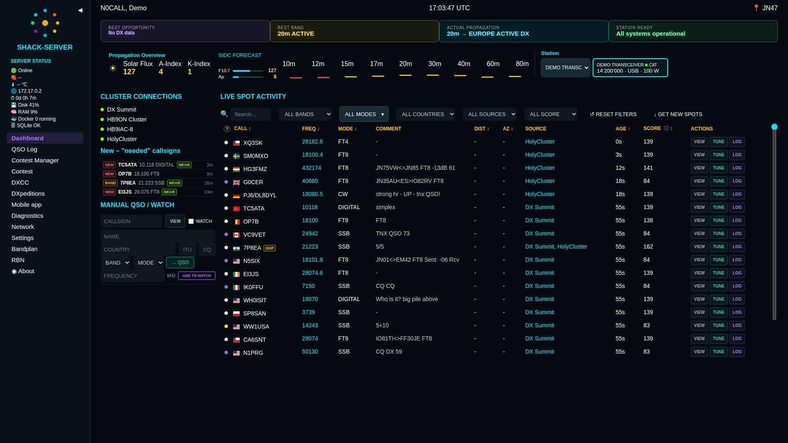

## Propagation Overview

The propagation display shows the current propagation conditions. The source is NOAA (National Oceanic and Atmospheric Administration, USA).

## SIDC Forecast

Unlike the current NOAA values, the SIDC forecast predicts propagation for the next hours. The source is the Solar Influences Data Analysis Center in Brussels.

## Best Opportunity

Best Opportunity shows the spot with the highest [DX score](#the-dx-score) – the station that is most worth working right now. A click opens the QSO window.

## Actual Propagation

Actual Propagation compares the model (NOAA/SIDC) with reality (the number of current DX spots per band):

| Display | Meaning |
|---|---|
| **OPENING** | Model and spots agree: the band is open. |
| **ACTIVE** | Many spots although the model only expects average conditions. |
| **POSSIBLE** | The model looks good, but there is hardly any activity right now. |

## Station and active transceiver

The **Station** area shows the active transceiver with name, CAT status, frequency, mode and power. To the left you choose the active transceiver from the ones set up; only one is active at a time.

If a transceiver with its own remote page is active (FTDX10, FTX-1, IC-7300, RGO ONE), the button with its name opens that page (see [Remote control](#remote-control)).

## Rotator control

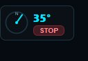{width=25%}

If an antenna rotator is set up, the Station area shows a compass with the current heading and a **STOP** button. A click on the **AZ** value of a spot turns the antenna in that direction. Setting it up is described in the chapter [Antenna rotator](#antenna-rotator).

## Manual QSO / Watch

Manual QSO is for quickly looking up a callsign that does not appear in the live spots – and for logging the QSO right away if you like.

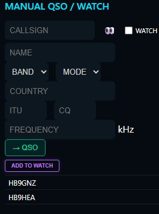{width=32%} 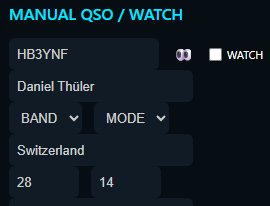{width=36%}

- **Enter** or **VIEW** looks the call up on QRZ.com: name, country, zones, locator.
- **VIEW** (the "eyes") also opens a window with a map and the QRZ picture.
- **→ QSO** opens the QSO window with this data.

### Call check while typing

A list opens below the field while you type:

- at once the **country** of the prefix with CQ and ITU zone – "SQ2" gives Poland. Country and zones go straight into the form.
- **suggestions**, most likely first:
  - stations **spotted on the air** right now, above all the ones near the transceiver frequency (green **◉ HERE** badge). If you heard "SQ2…" on 14.025 MHz, the station spotted there is at the top.
  - callsigns from your **own log** (`LOG 3×`) and the **watch list**.
  - the **SCP database** (Super Check Partial) with about 180,000 active callsigns from Club Log, updated weekly.
- The typed part may be anywhere in the callsign: "Q2A" finds SQ2ABC. A `?` stands for a character you did not copy: "SQ2?BC".
- **Misheard?** Callsigns with exactly one character different, extra or missing are shown with `≈`. Characters that sound alike in CW or SSB (S/H/5, B/D/6, M/N, P/T …) come first.
- Clicking into the **empty field** shows who is spotted on your frequency right now.

Arrow keys and **Enter** or a click take a suggestion: callsign, band, mode and frequency are filled in and the QRZ lookup runs.

### Watch list

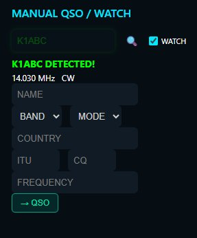{width=32%}

**WATCH** or **ADD TO WATCH** puts a callsign on the watch list; there is no limit. As soon as the station is spotted, the dashboard shows an alert, for example "K1ABC DETECTED! 14.030 MHz CW". Optionally a push notification goes to your phone as well (see [Notifications](#notifications)).

## New – "needed" callsigns

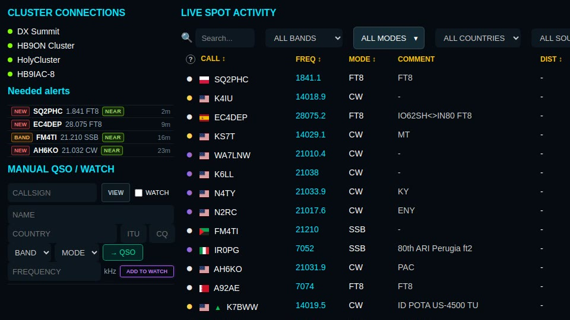

Below the watch list are the most recently spotted stations you still need – compared with your own log by DXCC entity: **NEW COUNTRY**, **NEW BAND COUNTRY** and optionally a new band or mode for a station already worked. **NEAR** means a spotter close to your QTH heard the station. A click tunes the transceiver. Setting it up: see [Notifications](#notifications).

## DX and live spots

The live spots show the stations currently reported, with frequency, mode, country, distance, bearing, source and score.

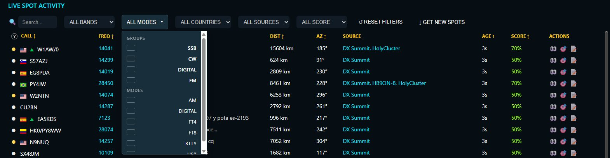

- Every column can be **sorted** up and down, the important fields have **filters**: band, mode (multiple choice), country, source.
- **Reset filters** clears all filters, **Get new spots** fetches new spots and keeps the filters.
- Hovering over the flag shows the country.
- **Eyes** (VIEW): a window with a world map, distance and bearing between your QTH and the DX station.
- **Target** (TUNE): sets frequency and mode on the transceiver.
- **Notepad**: opens the QSO window; frequency and mode, plus name and locator from QRZ.com, are filled in.
- **AZ**: turns the rotator towards the station.

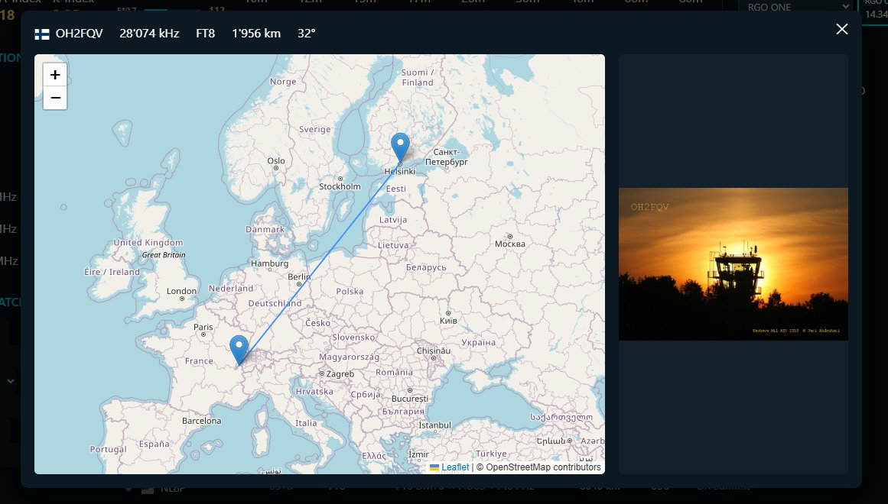

### Spot information

The coloured dots left of the flag show whether the station, country and band have been worked already. A click on **?** shows the legend.

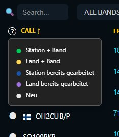{width=25%}

**POTA** stations are marked with a green triangle, **SOTA** stations with a white one. You can see at once whether it is a park or a summit activation.

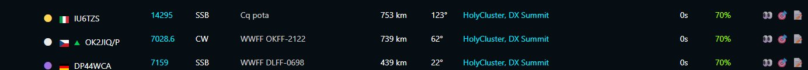

If the spot says "UP 2", "UP 1-3", "DOWN 1", "QSX 14025" or "LSN 14.205", the list shows the **split** as an orange badge next to the frequency (see [Split](#split)). A green **NEAR** means heard close to your QTH.

What makes SHACK-SERVER special: besides the DX clusters it also reads **HolyCluster** and **DX Summit**. The data is fused and enriched in the fusion engine – with country, distance, bearing, zones and SOTA / POTA information, among others.

### The DX score

The score is made of several independent parts:

| Criterion | Condition | Points |
|---|---|---:|
| Worked status: new | station, country and band new | +100 |
| Worked status: country | country known, station/band apparently new | 0 |
| Worked status: station | station worked before | −20 |
| Worked status: country-band | country worked, but new on this band | +60 |
| Worked status: station-band | station worked on this band before | −80 |
| New band for country | country known, but not yet on this band | +60 |
| New station on band | callsign known, but not yet on this band | +30 |
| New station | worked status "new" | +15 |
| Multi-cluster | spot from 2 or more sources | +20 |
| Heard near you | spotter close to your QTH (NEAR) | +15 |
| Confidence | 0–100 % | 0 to +15 |
| Spot age under 60 s | very fresh | +15 |
| Spot age 60–179 s | | +10 |
| Spot age 180–299 s | | +5 |
| Spot age 300 s or more | | 0 |
| Distance over 8000 km | | +15 |
| Distance 5000–8000 km | | +11 |
| Distance 2000–5000 km | | +7 |
| Distance up to 2000 km | | +3 |

# Logging a QSO

A click on the notepad of a spot (or **→ QSO** in Manual QSO) opens the QSO window. Frequency and mode are filled in, QRZ.com supplies name and locator.

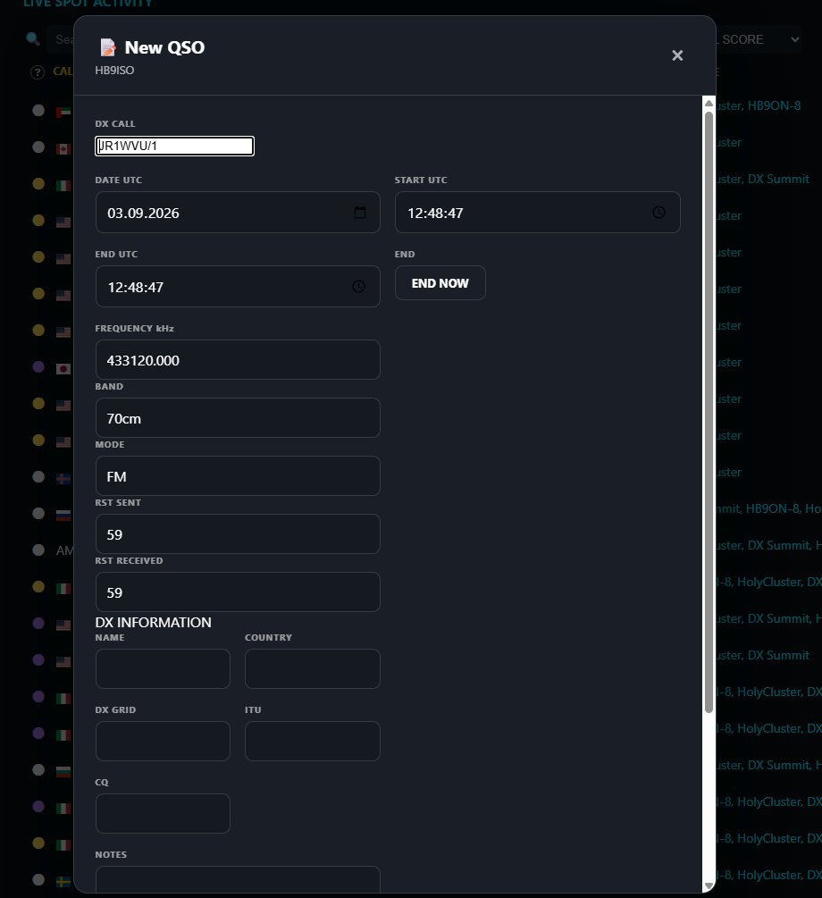{width=50%}

Saved QSOs go into the [QSO log](#qso-log) and – if set up – are uploaded to QRZ.com, Club Log and LoTW automatically.

# QSO log

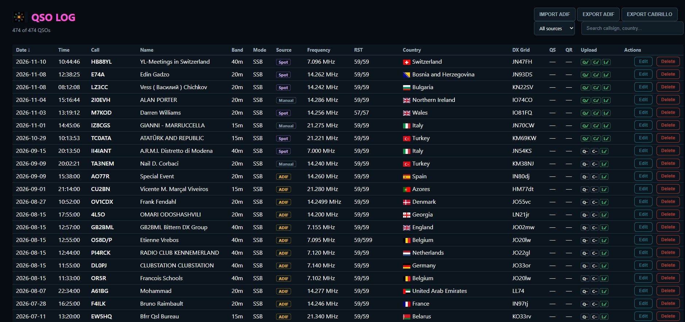

The QSO log holds all QSOs. The table can be sorted by date, time, callsign, name, band, mode, source, frequency, country and more. **Edit** and **Delete** change or remove a QSO.

- **Source** shows where a QSO came from: **Spot** (from the live spots), **Manual** (entered by hand), **ADIF** (imported) or, for example, WSJT-X. The **All sources** selector shows a single source only.
- **QS** / **QR**: QSL card sent / received.

The **Upload** column shows the state of every QSO at QRZ.com (Q), Club Log (C) and LoTW (L): ✓ uploaded, … waiting, ✖ error. Hovering over the mark shows the time or the error message. LoTW confirmations are shown and count in the [DXCC table](#dxcc-table).

## Search

The search field finds QSOs by callsign or country.

## ADIF import and export

**IMPORT ADIF** reads existing log data, for example from a previous logging program. **EXPORT ADIF** creates an ADIF file for other logging programs. POTA, SOTA and WWFF references are included.

## Online logbooks

SHACK-SERVER uploads new QSOs automatically in the background. This is set up under **Settings → Log Uploads**, with one account per own callsign. Portable callsigns (/P, /M, /QRP …) are matched to the account automatically, other forms (for example A61/HB9BC) via aliases.

| Service | What you need |
|---|---|
| **QRZ.com** | API key of the QRZ logbook (QRZ.com → Logbook → Settings) |
| **Club Log** | e-mail and app password of Club Log; the Club Log API key is entered once per installation |
| **LoTW** | callsign certificate (.p12) from TQSL; for confirmations also the LoTW website login |

**Test** checks the credentials. **Upload existing QSOs** queues the existing log as well.

### LoTW (Logbook of the World)

SHACK-SERVER signs the QSOs itself – TQSL is not needed on the Pi.

1. In TQSL on the PC: *Callsign Certificates* → right-click the callsign → *Save the Callsign Certificate File*. This gives a `.p12` file (password optional).
2. *Settings → Log Uploads*: save the logbook account, then **Add certificate (.p12)**. If the file has a password, enter it before choosing the file.
3. Tick **LoTW** and save. New QSOs are uploaded in the background; **Upload existing QSOs** queues the existing log (only QSOs within the certificate's date range).
4. For confirmations, enter the **LoTW website login**. Confirmations are fetched every 6 hours (or with **Fetch confirmations**) and count as confirmed in the DXCC table.

The station location uses the locator from *Settings → Station*, the DXCC number from the certificate and the zones of the country. If a country has several zones, they can be set per account. Not supported yet: US states, counties, Canadian provinces and other subdivisions.

# DXCC table

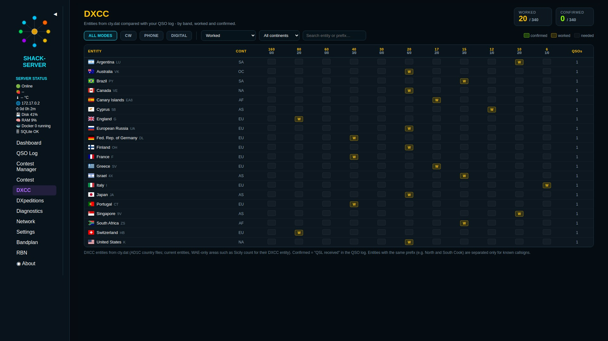

The DXCC table shows all 340 DXCC entities across the bands 160 m to 6 m: worked or confirmed (QSL or LoTW), for all modes, CW, phone or digital. Filters show, for example, only the missing entities (*Needed*), the ones worked but not yet confirmed, or a single continent.

# DXpeditions

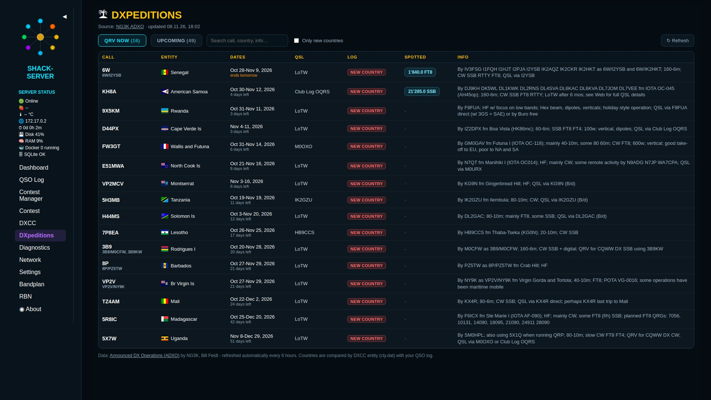

The **DXpeditions** page shows announced DX operations (source: NG3K ADXO), is updated automatically and compared with your log. **QRV NOW** are the running ones, **UPCOMING** the ones to come. If a DXpedition is being spotted right now, one click tunes the transceiver.

# Contest

The contest console is for fast operating during a contest. It contains contest selection, contest session, band statistics, QSO entry and a live band display.

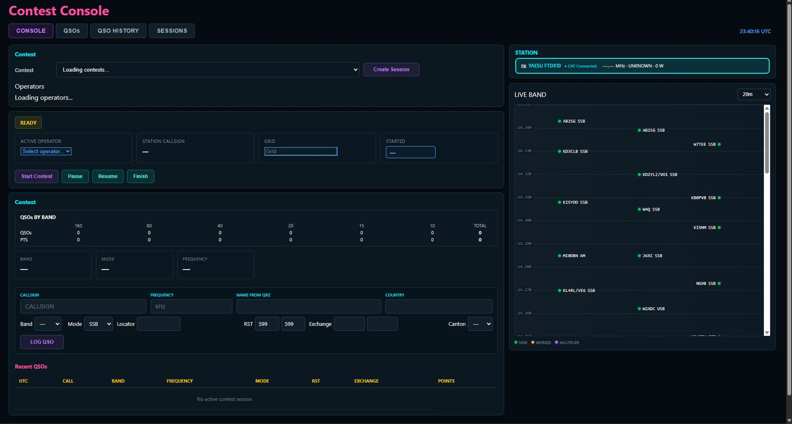

## Contest session

After choosing a contest you create a session, start, pause and end it. The contests themselves are entered in the [Contest Manager](#contest-manager). Several operators can work at the same time at different stations – all via the same address. Sessions and contest QSOs are available in the menu at the top left. Contest QSOs are stored separately from the normal logbook.

## QSO entry

QSO entry contains callsign, name, locator, RST sent and received and the exchange fields. Which exchange fields are needed is set in the contest configuration. If the sent exchange is set to **Serial Number**, SHACK-SERVER fills in the next number itself: the highest number sent in the session plus 1 – across all operators. With **CQ Zone**, **ITU Zone** or **Locator** the value comes from the station (club) callsign and the grid of the contest in the Contest Manager. A click on a spot in the live band display fills in callsign, mode and frequency.

While you type the callsign, the **call check** appears just like on the dashboard: country and zones from the prefix, suggestions from spots, your own log and the SCP database. In addition each suggestion shows the contest status of the session: **DUPE** (red) when the callsign is already logged on the selected band, and in yellow the bands it was already worked on. Take a suggestion with ↑/↓ and Enter or with a click – for a spot also band, mode and frequency. Enter logs the QSO only when no suggestion is highlighted. The first Esc closes the list, the second clears the entry.

## Live band

The live band display shows the spot activity on the selected band. The labels are spread over several lanes so they do not overlap.

## QSO history and Cabrillo

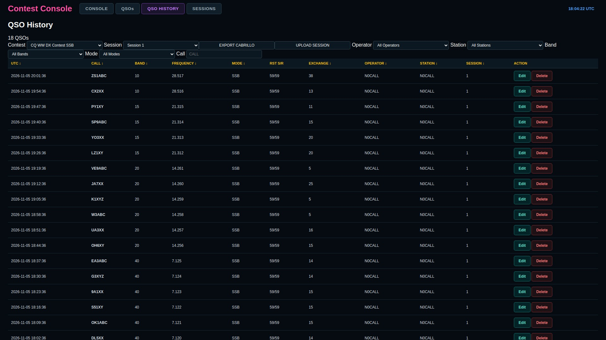

The QSO history shows all contest QSOs with operator and station. The **Cabrillo export** creates the file to submit to the contest organizer; it only contains the selected contest group.

# Contest Manager

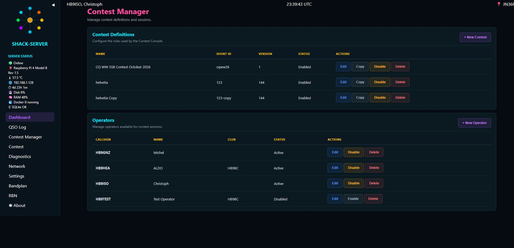

The Contest Manager manages the contests: they are entered here and then selected and started in the contest console. The callsigns taking part in contests are entered here as well.

# Station and transceivers

SHACK-SERVER controls all transceivers through one common interface. That is why the dashboard, the spots and the log work the same with every supported radio.

## Supported radios

| Transceiver | Connection | Status |
|---|---|---|
| Yaesu FTDX10 | USB / CAT, own driver | integrated, with remote page |
| Yaesu FTX-1 | USB / CAT, own driver | integrated, with remote page |
| RGO ONE | USB / CAT, own driver | integrated, with remote page |
| Icom IC-7300, IC-7300MK2 | USB / CI-V, own driver | integrated, with remote page and scope; test on the radio pending |
| Icom IC-705 and other Icom | USB / CI-V, own driver | prepared, hardware test pending |
| QRP Labs QMX / QMX+ | USB / CAT, own driver | prepared, hardware test pending |
| about 400 more models | Hamlib | integrated |

## Setting up a transceiver

**Settings → Transceivers → + Add Transceiver**:

1. Choose the **transceiver / driver** – an own driver or **Hamlib - other transceivers** with manufacturer and model.
2. Choose the **serial port**. Detected ports are shown with a readable name; on Yaesu radios with two ports the CAT port is marked.
3. **Baud rate** – must match the CAT setting in the transceiver's menu. With Hamlib usually *Model default*.
4. For Icom also the **CI-V address**.
5. **Test connection** – shows the current frequency if it works, otherwise the reason in plain words (radio off, wrong baud rate, port busy …).
6. **Save transceiver** – takes effect at once, no restart needed.

The transceiver reconnects automatically when it is switched on or the USB cable is plugged in again.

## Choosing the active transceiver

The dashboard only shows the active transceiver. It is chosen with the selector to the left of the station card.

## CAT status

The station card shows whether there is a CAT connection. Without a connection, frequency and mode are missing or shown as unknown. First aid: is the transceiver switched on? Is the baud rate right? Is the USB cable plugged in? The [Diagnostics](#diagnostics) page shows details.

## Sharing the transceiver with other programs

A serial port can only be opened by one program at a time. If WSJT-X or a logging program should also control the transceiver, start a shared `rigctld` and choose the connection **Existing rigctld** with the **Hamlib** driver in SHACK-SERVER.

## Split

If the spot says "UP 2", "UP 1-3", "DOWN 1", "QSX 14025", "QSX 025" or "LSN 14.205", **TUNE** sets the receive frequency on VFO A, the transmit frequency on VFO B and switches split on. Tuning a spot without split switches split off again. FT8 and FT4 spots are tuned without split (DXpedition mode in WSJT-X).

Supported: Yaesu FTDX10, Yaesu FTX-1, RGO ONE and all transceivers via Hamlib with split control. Switch it off under *Settings → Split & CW*. *Settings → Split & CW* also sets the **CW sideband**: CW-U or CW-L (Icom: CW or CW-R). It is used for every CW spot and every click on "CW", on all bands.

# Remote control

The remote pages operate the transceiver in the browser – in the shack or over the internet, with receive audio and microphone. Microphone audio only works over `https://` (a browser rule).

## Yaesu FTDX10

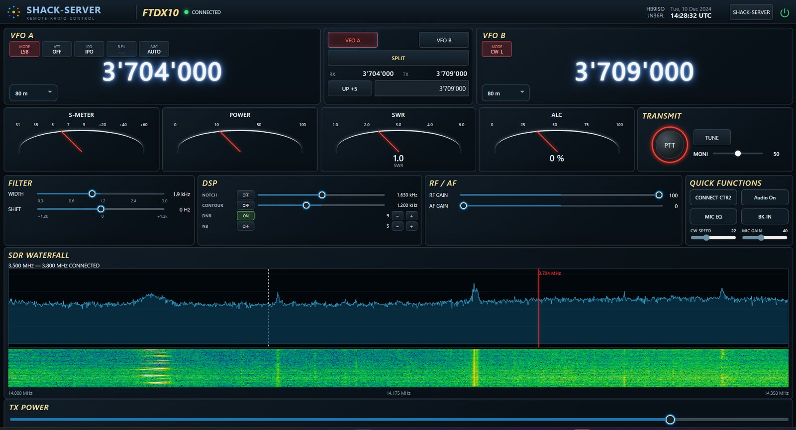

The FTDX10 interface is modelled on the radio: VFO A and B, all modes, filters (width, shift), notch, contour, DNR, NB, RF and AF gain, PTT, spectrum and waterfall from the SDR. The CTR2-MIDI controller is supported. You can switch between the classic Yaesu view and a monochrome view.

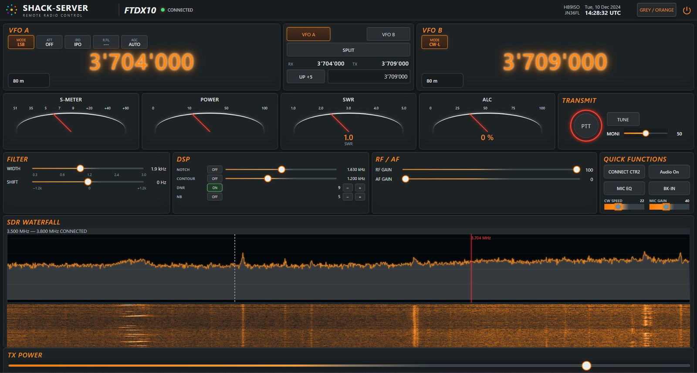

## Yaesu FTX-1

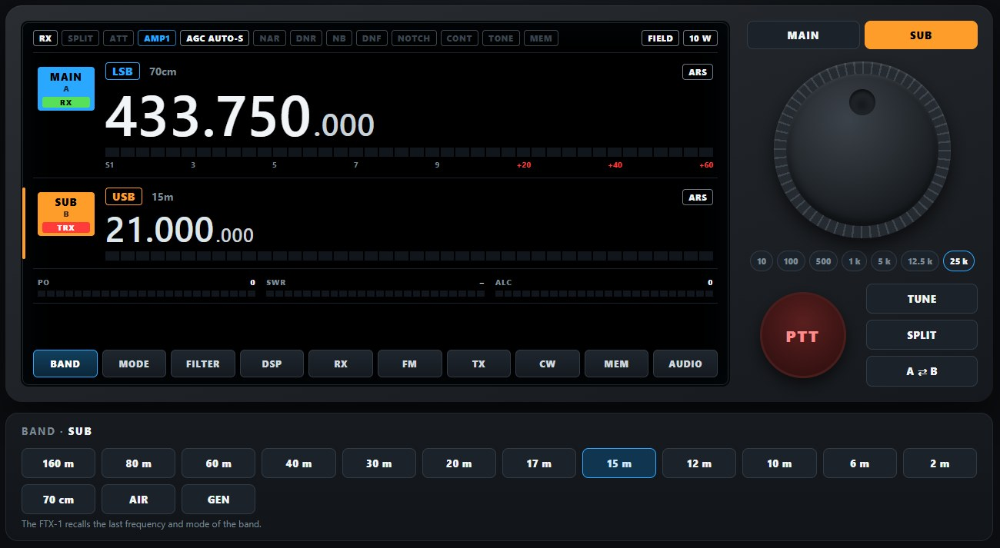

If the FTX-1 is the active transceiver, the **FTX-1** button on the dashboard opens its own page, designed after the radio's display:

- **MAIN** and **SUB** as on the radio; the transmitting side is marked **TRX** in red, the other one **RX** in green.
- S meter, PO, SWR, ALC.
- Tuning knob (drag, mouse wheel or arrow keys; steps from 10 Hz to 25 kHz), PTT (hold the button or the space bar), tuner, split.
- All bands including **2 m, 70 cm** and airband, all modes including C4FM.
- Filters, DSP (DNR, NB, DNF, notch, contour, APF), AF, RF, squelch, ATT, preamp, AGC.
- FM repeater shift, CTCSS and DCS.
- Power (field head 0.5–10 W, with SPA-1 / Optima 5–100 W), mic gain, processor.
- CW speed, break-in, CW memories 1–5, receive audio.

**MEM – memory channels:** **READ CHANNELS** reads channels 1–99 with name, frequency, mode, shift and tone (about 10 seconds). A channel can be recalled on MAIN or SUB; CH ▲/▼ steps through them, QMB stores and recalls. The current setting of MAIN or SUB can be stored in a channel with a name (with a question before overwriting), and channels can be renamed.

The page fits a 1920 × 1080 screen without scrolling.

## Icom IC-7300

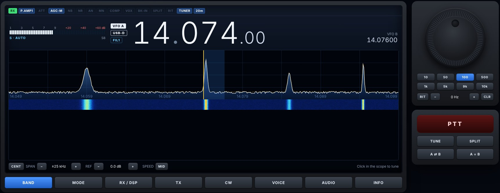

If the IC-7300 (or IC-7300MK2) is the active transceiver, the **IC-7300** button on the dashboard opens its own page in the style of the IC-7300 touchscreen:

- **Spectrum and waterfall straight from the IC-7300** over USB – no SDR needed. A click into the spectrum tunes there, the mouse wheel tunes in the set step. CENT/FIX, span (±2.5 kHz to ±500 kHz), reference level and speed as on the radio. The radio only sends scope data while the page is open.
- **Frequency:** the mouse wheel over a digit tunes exactly that digit; a click on the frequency opens the input. Tuning knob (drag or mouse wheel), steps 10 Hz to 10 kHz, arrow keys.
- **Status line** as at the top of the display: RX/TX, P.AMP, ATT, AGC, NB, NR, AN, MN, COMP, VOX, BK-IN, SPLIT, RIT, TUNER, band.
- **Meter:** S, PO, SWR, ALC – a click switches, AUTO shows PO while transmitting.
- **Soft keys** below: BAND, MODE (with DATA, FIL1–3, twin PBT), RX/DSP (P.AMP, ATT, AGC, NB, NR, AN, MN, RF gain, squelch), TX (power, mic gain, compressor, VOX, monitor, tuner), CW (speed, break-in, send text, macros F1–F5), VOICE (voice memories T1–T8), AUDIO.
- **PTT** (hold the button or the space bar), TUNE, SPLIT, A⇄B, A=B, RIT.

Settings on the IC-7300: *SET › Connectors › CI-V*: **CI-V USB Baud Rate** 115200, **CI-V Address** 94h (IC-7300MK2: B6h), **CI-V Transceive** ON, **CI-V USB Echo Back** OFF. In SHACK-SERVER choose the driver **Icom IC-7300 / IC-7300MK2**.

## RGO ONE, QRP Labs QMX and others

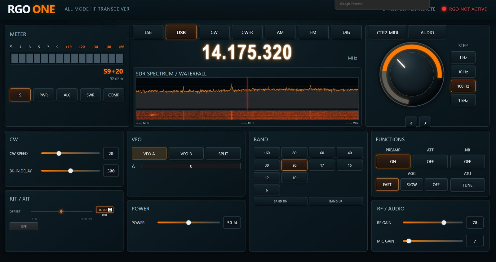

The RGO ONE has its own remote page with modes, tuning steps, CW speed, break-in, power, bands, AGC, tuner and RF and mic gain.

As with Yaesu, the waterfall is not sent over USB; the SDRplay SDR is integrated for this (see [SDR](#sdr-sdrplay-rsp1b)). Other radios with CAT can be added with little effort; for remote operation with audio the radio only needs a USB sound card.

## CTR2-MIDI

The **CTR2-MIDI** controller by Lynovation has a comfortable VFO knob and six buttons. It is **not** connected to the Raspberry Pi but by USB to the computer or tablet that shows the remote page. The browser reads it via WebHID (Chrome or Edge, over `https://`). One step of the knob changes the frequency of the active VFO by 10 Hz.

# SDR (SDRplay RSP1B)

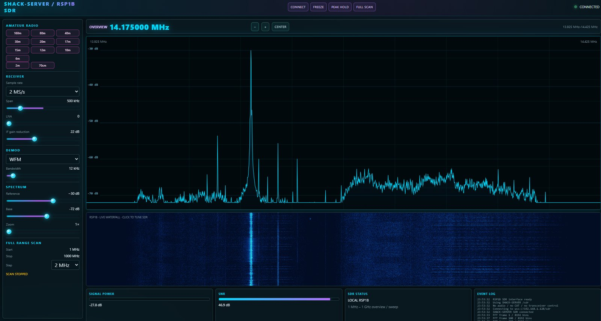

SHACK-SERVER has its own SDR page for the **SDRplay RSP1B**: spectrum and waterfall, demodulation, peak hold, band overview from 160 m to 70 cm and a scan over the whole range.

On the remote pages the RSP1B serves as a separate SDR for the transceiver's spectrum and waterfall. It is independent of the CAT connection; the transceiver frequency decides which part is shown.

**CONNECT / DISCONNECT:** the RSP1B only runs while it is needed – while running it takes a whole CPU core of the Raspberry Pi. **DISCONNECT** stops it on the server (status at the top right **STOPPED**), **CONNECT** starts it again (**CONNECTED**). It also stops by itself: 60 seconds after the last page was closed, and when the SDR page or a remote page has been in the background for 60 seconds. A running **FULL SCAN** is not interrupted. It starts again by itself the next time the page is opened.

The SDR page is switched on under *Settings → Optional Modules*.

# RBN & Memory

The **Reverse Beacon Network (RBN)** is a worldwide network of receiving stations (skimmers) that listen to the amateur bands around the clock. They decode CW and digital modes, recognise the callsign, measure signal strength (SNR) and speed and report it at once.

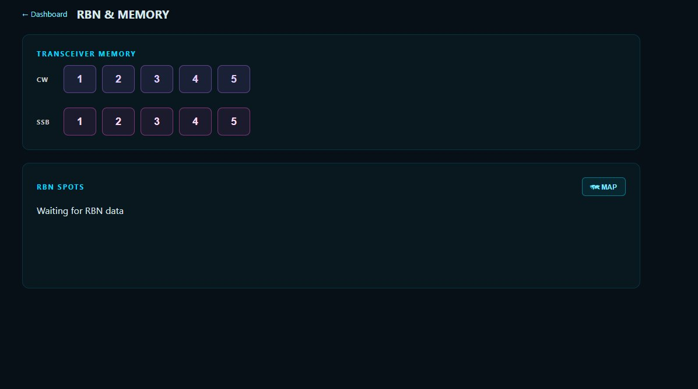

The **RBN & Memory** page combines both:

- **Transceiver Memory**: ten buttons for the transceiver's voice or CW memories (Yaesu), plus frequency and mode, which can also be changed here.
- **RBN Spots**: as soon as skimmers report your own callsign, they appear in the list and on the map – you see at once how well and where your signal is getting out. Typical use: send CQ with a memory button and watch who hears you.

The page is switched on under *Settings → Optional Modules*. Independently of it, SHACK-SERVER uses the complete RBN feed for the live spots and for "heard near you".

# SOTA and POTA

SOTA and POTA activations are recognised in the spots and marked in the live spots: POTA with a green, SOTA with a white triangle. SOTA spots come from the SOTA cluster, POTA spots from the POTA interface.

If these markers are missing, SHACK-SERVER itself still works; usually the external service is not reachable at the moment. The [Diagnostics](#diagnostics) page shows such problems.

If you activate yourself, use the portable log of the [phone app](#phone-app-and-portable-log).

# Phone app and portable log

On the phone, open the address of your SHACK-SERVER with `/m`, for example `https://shack.example.com/m`, and choose **Add to Home Screen** (iPhone: share menu, Android: browser menu or the *Install* button). Installing it as an app needs `https://`.

The app shows:

- new "needed" callsigns and watch list hits,
- live spots – tap to tune the transceiver, with split,
- the transceiver: band, mode, split off, rotator,
- a quick QSO log.

**Portable log:** in the LOG tab, switch to **PORTABLE**. Own callsign with /P or /M, locator from the phone's GPS, POTA, SOTA or WWFF reference (and the other station's reference for park-to-park or summit-to-summit), band and mode with one tap, also 2 m and 70 cm.

Without network – on a summit, in a park – the QSOs stay on the phone and are sent automatically as soon as SHACK-SERVER can be reached again, every QSO only once. The references go into the ADIF upload. The counter shows the QSOs of the activation (POTA 10, SOTA 4, WWFF 44).

# Notifications

SHACK-SERVER checks every new spot – also when no browser is open – and sends a push notification to your phone when something matches. It uses the free app **ntfy**.

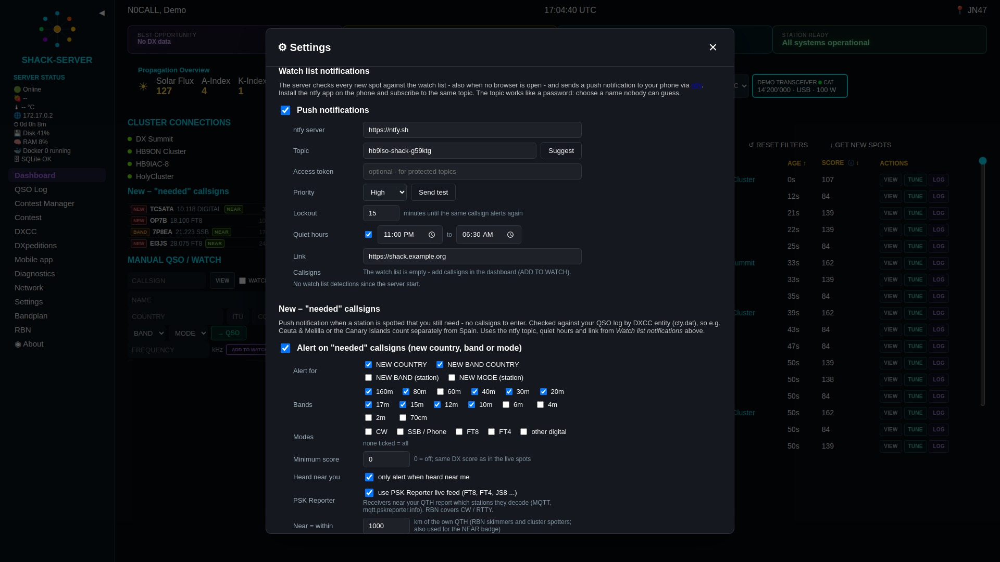

## Setting up

1. Install the **ntfy** app (Android or iOS).
2. **Settings → Watch list notifications**: tick *Push notifications*, create a hard-to-guess topic name with **Suggest**, **Save**.
3. In the ntfy app: *Subscribe to topic* with the same topic name (server ntfy.sh).
4. **Send test**.

The **lockout** (default 15 minutes) prevents repeated alerts for the same station, **quiet hours** suppress notifications at night. Under **Link** enter the address of your SHACK-SERVER; tapping the notification opens it.

## Watch list

The bell 🔔 next to each callsign of the watch list switches the push notification for that callsign on or off. Example: `FW3GT DETECTED – 14.001 MHz CW – Wallis & Futuna – via RBN`.

## New – "needed" callsigns

**Settings → New – "needed" callsigns** reports stations you still need – without entering callsigns. They are compared with your log by DXCC entity; the Canary Islands, Asiatic Russia and so on count separately.

- Levels: **NEW COUNTRY**, **NEW BAND COUNTRY**, optionally **NEW BAND** and **NEW MODE** for a station already worked.
- Filters: bands, modes, minimum score, *only when heard in my region*.
- Lockout per country and band: a pileup alerts only once.

## Heard near you

A station counts as **heard near you** (NEAR) when a spotter within the set radius of your QTH (default 1000 km) reported it on this band in the last 15 minutes. Sources are the complete RBN feed, the spotters of the DX clusters and optionally **PSK Reporter** for FT8, FT4 and other digital modes.

# WSJT-X

QSOs logged in **WSJT-X** or **JTDX** are taken into the log automatically and uploaded like all other QSOs.

1. **Settings → WSJT-X**: tick *Receive QSOs from WSJT-X / JTDX*, port (default 2237).
2. In WSJT-X: *Settings → Reporting → UDP Server* = IP address of SHACK-SERVER, port as above, tick *Accept UDP requests*.

If several programs (JTAlert, GridTracker) share the stream, enter the same multicast address in both places, for example 224.0.0.1.

# Antenna rotator

SHACK-SERVER turns the antenna via Hamlib. All controllers known to Hamlib are supported, for example Yaesu GS-232, SPID Rot2Prog, Hy-Gain DCU-1, ERC and K3NG.

1. **Settings → Rotator** → tick **Use a rotator**.
2. **Controller on a serial port**: choose manufacturer, model and port (baud rate usually *Model default*).
   Or **Existing rotctld**: host and port of a `rotctld` that is already running, for example shared with PSTRotator or N1MM.
3. **Test** shows the current antenna heading.
4. **Save**.

The compass then appears on the dashboard. A click on the **AZ** value of a spot turns the antenna; the spot details (VIEW) offer short path and long path.

# Telnet server / DX cluster on port 8000

On port **8000** SHACK-SERVER is a DX cluster itself and can be used in other logging programs – with all fused spots. Use the IP address or name of SHACK-SERVER, port 8000, and log in with your callsign. No password is needed.

# Network and system

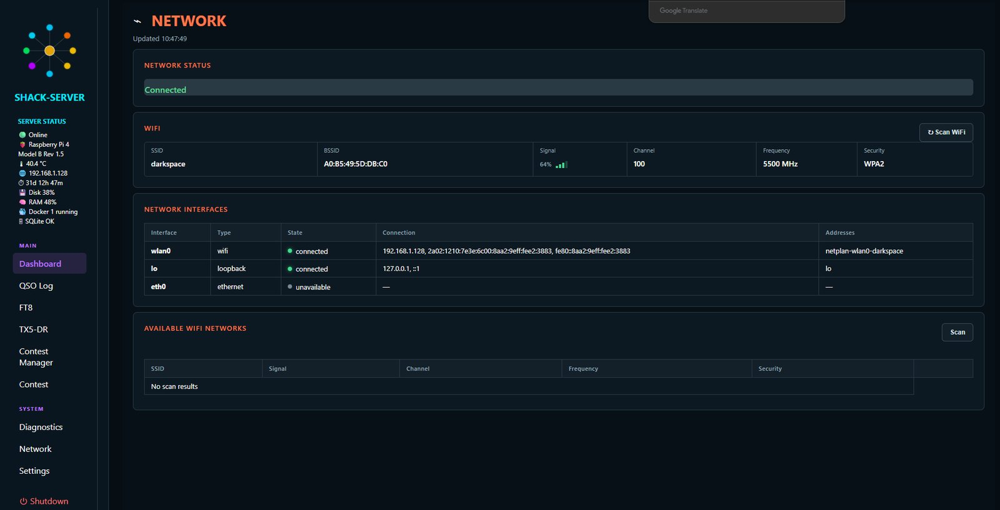

The **Network** page shows the network and the system state of the Raspberry Pi. For portable use there is a **Wi-Fi scan**: list the available networks and connect to one.

The system actions restart SHACK-SERVER, reboot the Raspberry Pi or shut it down.

## Access from outside

SHACK-SERVER has no login of its own. For access from the internet, therefore never simply forward a port in the router, but use a protected way, for example **Cloudflare Access**: only people you allow get through, after logging in. The installation guide describes the setup. The same applies to the phone app on the road and to microphone audio, which needs `https://`.

# Settings

Open the settings with **Settings** in the sidebar. They are divided into sections:

| Section | Content | Chapter |
|---|---|---|
| Station | callsign, name, locator, club; link to the setup assistant (also for the QRZ.com login) | [Getting started](#getting-started) |
| Transceivers | set up, test and activate transceivers | [Station and transceivers](#station-and-transceivers) |
| DX Sources | switch DX clusters (DXSpider), DX Summit and HolyCluster on and off, add your own clusters | [DX and live spots](#dx-and-live-spots) |
| Log Uploads | QRZ.com, Club Log, LoTW per callsign | [Online logbooks](#online-logbooks) |
| WSJT-X | take over QSOs from WSJT-X / JTDX | [WSJT-X](#wsjt-x) |
| Split & CW | switch automatic split on and off, CW sideband (CW-U / CW-L) | [Split](#split) |
| Rotator | antenna rotator | [Antenna rotator](#antenna-rotator) |
| Watch list notifications | push notifications, lockout, quiet hours | [Notifications](#notifications) |
| New – "needed" callsigns | alerts for new countries and bands, heard near you | [Notifications](#notifications) |
| Backup | daily backup to Dropbox / NAS | [Backup](#backup) |
| Software update | install a new version | [Updates](#updates) |
| Optional Modules | RBN & Memory, SDR | [RBN & Memory](#rbn-memory), [SDR](#sdr-sdrplay-rsp1b) |

Credentials (passwords, API keys) stay on SHACK-SERVER and are never sent back to the browser. An empty password field means: the saved password is kept.

# Backup

**Settings → Backup** saves the QSO and contest log, the settings and the transceivers once a day at the set time. How many backups are kept can be set.

- **Dropbox, Google Drive, OneDrive …** via *rclone*. The target is set up once on the Pi (see the installation guide), then enter for example `dropbox:SHACK-SERVER` in the settings and press **Test**.
- **NAS (SMB)**: address, share, folder, user and password of the NAS. **Test** checks the access.

**Backup now** saves at once. The last three backups are also kept on the Pi. Restoring is described in the installation guide.

# Data import and export

**ADIF** is the main exchange format for log data. Import takes existing QSOs into SHACK-SERVER, export makes them available to other logging programs (see [QSO log](#qso-log)).

**Cabrillo** is used for contest logs and only contains the selected contest group (see [Contest](#contest)).

# Diagnostics

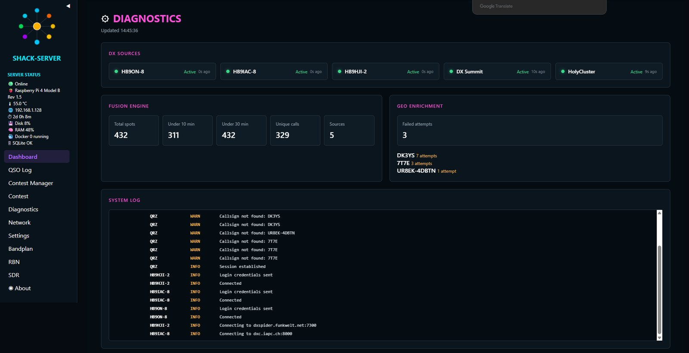

The **Diagnostics** page shows the state of SHACK-SERVER: connections to the DX clusters, CAT, problems with external services (SOTA, POTA, QRZ.com, uploads) and callsigns that QRZ.com has no entry for. **Run System Check** starts a fresh check.

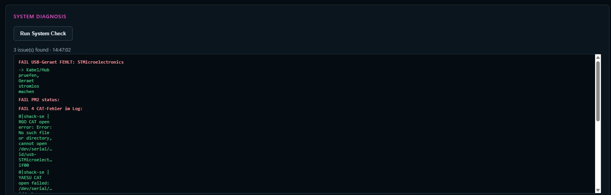

# Band plan

**Bandplan** in the sidebar shows the band plans from 160 m to 70 cm.

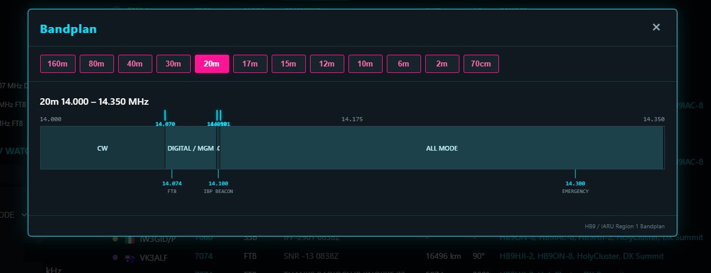

# Appendix

## Terms

| Term | Meaning |
|---|---|
| ADIF | Amateur Data Interchange Format – exchange format for log data |
| Cabrillo | standard format for contest logs |
| CAT | Computer Aided Transceiver – control of a transceiver by software |
| CI-V | Icom's control protocol |
| Club Log | online logbook and DXCC analysis |
| DXCC | DX Century Club – list of the 340 DXCC entities |
| Hamlib | library to control transceivers and rotators |
| LoTW | ARRL Logbook of the World – electronic QSL confirmation |
| NOAA | National Oceanic and Atmospheric Administration, USA |
| ntfy | free service for push notifications to the phone |
| POTA | Parks on the Air |
| PSK Reporter | network of receiving stations for digital modes |
| QRZ.com | callsign database and online logbook |
| RBN | Reverse Beacon Network |
| SCP | Super Check Partial – list of active callsigns |
| SIDC | Solar Influences Data Analysis Center, Brussels |
| SOTA | Summits on the Air |
| WWFF | World Wide Flora and Fauna |

## Addresses and ports

| Address / port | Purpose |
|---|---|
| `http://shack-server.local:3000` | web interface in the home network (ready-made image) |
| `/setup` | setup assistant |
| `/m` | phone app |
| `/ftx1` | Yaesu FTX-1 remote page |
| Port 3000 | web interface (HTTP) |
| Port 443 | web interface via HTTPS (with Caddy, optional) |
| Port 8000 | own DX cluster (Telnet) |
| UDP 2237 | QSOs from WSJT-X / JTDX |
